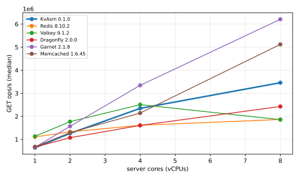
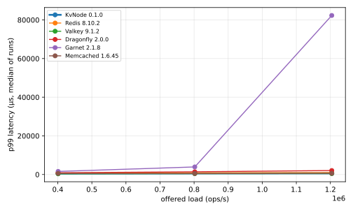
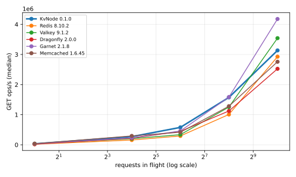

# KvNode benchmark report

Profile **standard**, recorded 2026-09-26T00:22:47 UTC, repository revision `ba9e005d2a06`. Method: [METHODOLOGY.md](../../METHODOLOGY.md).

## Environment

- CPU: 13th Gen Intel(R) Core(TM) i9-13900K, 32 vCPUs seen by the container VM; Docker Desktop, kernel 5.15.153.1-microsoft-standard-WSL2
- Docker 27.3.1, cgroup v1 (cgroupfs), security options ['name=seccomp,profile=unconfined']
- Placement: server on vCPUs 0..N-1, kvbench on 16-31 with 16 threads, loopback in the server's network namespace
- CPU clock factor 1.0613 (cgroup CPU time per wall second on a known load; server CPU figures are divided by it)

| System | Image | Configuration |
|---|---|---|
| KvNode 0.1.0 | `kvnode:0.1.0` `d99969812c82bf8d577` | gRPC over h2c; one worker thread per core (KVNODE_WORKERS). |
| Redis 8.10.2 | `redis:8.10.2` `426335161ea6c23f3b3` | Persistence off (--save '' --appendonly no); io-threads = tuned thread count (commands still execute on the main thread). |
| Valkey 9.1.2 | `valkey/valkey:9.1.2` `faa14c828e611eb9dfd` | Persistence off; io-threads = tuned thread count. 9.2 was only a release candidate at test time. |
| Dragonfly 2.0.0 | `ghcr.io/dragonflydb/dragonfly:v2.0.0` `9a0d5f8f474b3631233` | Snapshots off (--dbfilename=); proactor_threads = tuned thread count; memlock unlimited as its docs require; io_uring is available on this host (seccomp unconfined), so Dragonfly uses its preferred I/O engine. |
| Garnet 2.1.8 | `kvbench/garnet:2.1.8` `8a297dea4465e17cfcc` | Built from Microsoft's own Dockerfile at tag v2.1.8 (the newest published image, 2.1.0, is eight releases older; 'latest' is an unreleased main build). Defaults: AOF off; the .NET thread pool sizes itself from the cpuset, so there is no thread knob to tune. |
| Memcached 1.6.45 | `memcached:1.6.45` `3de3fa823e6482be4ad` | Meta protocol (mg/ms/mn); -t = tuned thread count; -m sized so nothing is evicted; UDP off. |

## Run validity

| Experiment | ok | invalid | failed |
|---|---|---|---|
| E0 | 90 | 0 | 0 |
| E1 | 144 | 0 | 0 |
| E2 | 144 | 0 | 0 |
| E3 | 36 | 0 | 0 |
| E4 | 54 | 0 | 0 |
| E5 | 36 | 0 | 0 |
| E6 | 36 | 0 | 0 |
| E7 | 90 | 0 | 0 |
| E8 | 21 | 0 | 0 |
| S1 | 60 | 0 | 0 |

Client-bound runs (client > 85% busy, server < 90%): 0.

## Host interference

Load from programs outside the container VM was **not monitored** in this session (run.py needs psutil and Docker Desktop's VM process, and sessions before 2026-09-26 09:44 predate the monitor). Such load competes for the same cores without appearing in any cgroup; see METHODOLOGY.md §8.

## E0 — Thread-count tuning

Median GET throughput for each thread setting; the better one (bold) is used by every later experiment.

| System | Cores | threads = N−1 | threads = N |
|---|---|---|---|
| KvNode 0.1.0 | 2 | 564 k (371–606 k) | **1.01 M (540–1.18 M)** |
| KvNode 0.1.0 | 4 | 1.72 M (1.38–1.79 M) | **1.96 M (1.75–2.06 M)** |
| KvNode 0.1.0 | 8 | **2.98 M (2.00–3.77 M)** | 2.84 M (1.59–3.13 M) |
| Redis 8.10.2 | 2 | 794 k (698–876 k) | **1.06 M (798–1.26 M)** |
| Redis 8.10.2 | 4 | 1.10 M (690–2.31 M) | **1.49 M (1.39–1.69 M)** |
| Redis 8.10.2 | 8 | 1.47 M (1.24–2.61 M) | **1.53 M (1.36–1.64 M)** |
| Valkey 9.1.2 | 2 | 795 k (660–1.09 M) | **1.46 M (748–1.85 M)** |
| Valkey 9.1.2 | 4 | **2.05 M (1.68–2.28 M)** | 1.66 M (804–2.10 M) |
| Valkey 9.1.2 | 8 | 1.39 M (1.03–1.41 M) | **1.60 M (1.41–1.82 M)** |
| Dragonfly 2.0.0 | 2 | 535 k (414–675 k) | **1.03 M (655–1.14 M)** |
| Dragonfly 2.0.0 | 4 | 1.09 M (1.05–1.31 M) | **1.49 M (1.30–2.11 M)** |
| Dragonfly 2.0.0 | 8 | 1.38 M (874–1.98 M) | **1.77 M (1.26–2.11 M)** |
| Memcached 1.6.45 | 2 | 661 k (584–752 k) | **943 k (752–1.30 M)** |
| Memcached 1.6.45 | 4 | **2.02 M (1.88–2.09 M)** | 1.88 M (1.05–2.46 M) |
| Memcached 1.6.45 | 8 | **4.97 M (1.52–5.29 M)** | 4.29 M (3.17–4.60 M) |

## E1 — Throughput scaling (100% GET, 100-byte values, 1M keys, uniform)

| Throughput (ops/s) | 1 core | 2 cores | 4 cores | 8 cores |
|---|---|---|---|---|
| KvNode 0.1.0 | 635 k (611–778 k) | 1.26 M (1.15–1.42 M) | 2.34 M (1.81–2.60 M) | 3.46 M (3.31–4.41 M) |
| Redis 8.10.2 | 1.10 M (980–1.26 M) | 1.33 M (1.23–1.54 M) | 1.61 M (1.42–1.88 M) | 1.86 M (1.72–2.13 M) |
| Valkey 9.1.2 | 1.13 M (959–1.29 M) | 1.77 M (1.48–2.00 M) | 2.51 M (1.73–2.76 M) | 1.85 M (1.43–1.99 M) |
| Dragonfly 2.0.0 | 666 k (602–742 k) | 1.07 M (1.01–1.27 M) | 1.60 M (1.25–1.75 M) | 2.43 M (2.37–2.52 M) |
| Garnet 2.1.8 | 654 k (507–786 k) | 1.56 M (1.49–1.75 M) | 3.34 M (3.11–3.63 M) | 6.21 M (3.28–7.42 M) |
| Memcached 1.6.45 | 677 k (604–706 k) | 1.29 M (1.25–1.40 M) | 2.14 M (2.08–2.39 M) | 5.12 M (2.97–5.99 M) |
| *KvNode ÷ Redis* | 0.58× [0.56–0.63] sign p=0.031 ▼ | 0.95× [0.92–0.96] sign p=0.031 ▼ | 1.46× [1.21–1.54] sign p=0.031 ▲ | 1.86× [1.76–2.09] sign p=0.031 ▲ |
| *KvNode ÷ Valkey* | 0.56× [0.55–0.64] sign p=0.031 ▼ | 0.71× [0.65–0.82] sign p=0.031 ▼ | 0.94× [0.90–1.10] sign p=0.688 ≈ | 1.87× [1.72–2.44] sign p=0.031 ▲ |
| *KvNode ÷ Dragonfly* | 0.95× [0.94–1.06] sign p=0.688 ≈ | 1.17× [1.10–1.19] sign p=0.031 ▲ | 1.46× [1.41–1.52] sign p=0.031 ▲ | 1.43× [1.36–1.75] sign p=0.031 ▲ |
| *KvNode ÷ Garnet* | 0.97× [0.91–1.21] sign p=0.688 ≈ | 0.80× [0.76–0.83] sign p=0.031 ▼ | 0.70× [0.53–0.76] sign p=0.031 ▼ | 0.56× [0.52–1.07] sign p=0.219 ≈ |
| *KvNode ÷ Memcached* | 0.94× [0.90–1.10] sign p=0.688 ≈ | 0.97× [0.88–1.02] sign p=0.688 ≈ | 1.09× [0.86–1.13] sign p=0.219 ≈ | 0.68× [0.64–1.18] sign p=0.219 ≈ |

**CPU efficiency** — operations per server CPU-second (higher is better):

| ops per CPU-second | 1 core | 2 cores | 4 cores | 8 cores |
|---|---|---|---|---|
| KvNode 0.1.0 | 628 k (601–763 k) | 623 k (572–705 k) | 577 k (448–640 k) | 493 k (473–612 k) |
| Redis 8.10.2 | 1.09 M (968–1.25 M) | 800 k (745–993 k) | 607 k (525–721 k) | 433 k (406–483 k) |
| Valkey 9.1.2 | 1.12 M (949–1.27 M) | 880 k (738–979 k) | 814 k (565–909 k) | 235 k (188–250 k) |
| Dragonfly 2.0.0 | 652 k (604–739 k) | 534 k (509–625 k) | 415 k (317–456 k) | 312 k (300–331 k) |
| Garnet 2.1.8 | 641 k (505–777 k) | 776 k (748–886 k) | 894 k (869–960 k) | 882 k (605–1.03 M) |
| Memcached 1.6.45 | 673 k (596–688 k) | 643 k (625–706 k) | 610 k (588–670 k) | 637 k (396–737 k) |
| *KvNode ÷ Redis* | 0.57× [0.55–0.62] sign p=0.031 ▼ | 0.78× [0.71–0.78] sign p=0.031 ▼ | 0.95× [0.79–1.03] sign p=0.219 ≈ | 1.14× [1.09–1.27] sign p=0.031 ▲ |
| *KvNode ÷ Valkey* | 0.56× [0.55–0.63] sign p=0.031 ▼ | 0.71× [0.65–0.81] sign p=0.031 ▼ | 0.71× [0.68–0.83] sign p=0.031 ▼ | 2.10× [1.97–2.66] sign p=0.031 ▲ |
| *KvNode ÷ Dragonfly* | 0.96× [0.94–1.05] sign p=0.688 ≈ | 1.17× [1.11–1.20] sign p=0.031 ▲ | 1.39× [1.32–1.46] sign p=0.031 ▲ | 1.58× [1.51–1.86] sign p=0.031 ▲ |
| *KvNode ÷ Garnet* | 0.98× [0.91–1.19] sign p=0.219 ≈ | 0.80× [0.76–0.84] sign p=0.031 ▼ | 0.65× [0.49–0.69] sign p=0.031 ▼ | 0.56× [0.53–0.83] sign p=0.031 ▼ |
| *KvNode ÷ Memcached* | 0.93× [0.90–1.11] sign p=0.688 ≈ | 0.97× [0.90–1.01] sign p=0.219 ≈ | 0.95× [0.74–0.99] sign p=0.031 ▼ | 0.77× [0.74–1.27] sign p=0.219 ≈ |

**Server CPU utilization** of its core budget (1.0 = all given cores busy; ▲ only means KvNode kept more of its cores busy, which is neither good nor bad by itself):

| utilization | 1 core | 2 cores | 4 cores | 8 cores |
|---|---|---|---|---|
| KvNode 0.1.0 | 1.02 (1.01–1.02) | 1.01 (1.00–1.02) | 1.01 (1.01–1.02) | 0.88 (0.87–0.90) |
| Redis 8.10.2 | 1.01 (1.00–1.01) | 0.82 (0.77–0.85) | 0.67 (0.65–0.68) | 0.54 (0.53–0.55) |
| Valkey 9.1.2 | 1.01 (1.00–1.02) | 1.00 (1.00–1.02) | 0.76 (0.75–0.77) | 0.98 (0.95–1.01) |
| Dragonfly 2.0.0 | 1.00 (1.00–1.02) | 1.00 (0.99–1.01) | 0.97 (0.95–0.98) | 0.97 (0.95–1.00) |
| Garnet 2.1.8 | 1.01 (1.00–1.03) | 1.00 (0.99–1.01) | 0.93 (0.89–0.94) | 0.88 (0.68–0.90) |
| Memcached 1.6.45 | 1.01 (1.00–1.03) | 1.00 (0.99–1.01) | 0.88 (0.87–0.89) | 1.00 (0.94–1.02) |
| *KvNode ÷ Redis* | 1.01× [0.99–1.01] sign p=0.219 ≈ | 1.22× [1.19–1.30] sign p=0.031 ▲ | 1.52× [1.49–1.56] sign p=0.031 ▲ | 1.63× [1.59–1.69] sign p=0.031 ▲ |
| *KvNode ÷ Valkey* | 1.00× [0.99–1.02] sign p=1.000 ≈ | 1.00× [0.98–1.02] sign p=0.688 ≈ | 1.33× [1.32–1.35] sign p=0.031 ▲ | 0.90× [0.87–0.93] sign p=0.031 ▼ |
| *KvNode ÷ Dragonfly* | 1.01× [0.99–1.02] sign p=0.219 ≈ | 1.00× [0.99–1.02] sign p=1.000 ≈ | 1.05× [1.03–1.07] sign p=0.031 ▲ | 0.90× [0.89–0.95] sign p=0.031 ▼ |
| *KvNode ÷ Garnet* | 1.00× [0.98–1.01] sign p=0.688 ≈ | 1.01× [0.99–1.02] sign p=0.219 ≈ | 1.09× [1.08–1.13] sign p=0.031 ▲ | 1.00× [0.98–1.29] sign p=1.000 ≈ |
| *KvNode ÷ Memcached* | 1.01× [0.99–1.02] sign p=0.688 ≈ | 1.01× [0.99–1.03] sign p=0.219 ≈ | 1.15× [1.14–1.16] sign p=0.031 ▲ | 0.87× [0.87–0.93] sign p=0.031 ▼ |

**Memory per key** after preloading 1M keys (anonymous memory delta ÷ keys; 16-byte key + 100-byte value = 116 raw bytes; lower is better):

| bytes / key | all E1 runs |
|---|---|
| KvNode 0.1.0 | 178 B (178–178 B) |
| Redis 8.10.2 | 174 B (170–175 B) |
| Valkey 9.1.2 | 173 B (172–174 B) |
| Dragonfly 2.0.0 | 158 B (155–163 B) |
| Garnet 2.1.8 | 284 B (274–288 B) |
| Memcached 1.6.45 | 196 B (196–198 B) |
| *KvNode ÷ Redis* | 1.02× [1.02–1.04] sign p<0.001 ▼ |
| *KvNode ÷ Valkey* | 1.03× [1.03–1.03] sign p<0.001 ▼ |
| *KvNode ÷ Dragonfly* | 1.12× [1.09–1.15] sign p<0.001 ▼ |
| *KvNode ÷ Garnet* | 0.63× [0.62–0.65] sign p<0.001 ▲ |
| *KvNode ÷ Memcached* | 0.91× [0.90–0.91] sign p<0.001 ▲ |

## E2 — Read/write mixes (4 cores)

100-byte values, 1M keys; Zipf uses YCSB's scrambled Zipfian with θ = 0.99.

| Throughput (ops/s) | 90% GET | 50% GET | 100% SET | 90% GET, Zipf 0.99 |
|---|---|---|---|---|
| KvNode 0.1.0 | 3.00 M (2.90–3.07 M) | 2.41 M (2.29–2.45 M) | 1.75 M (1.66–1.77 M) | 3.00 M (2.90–3.06 M) |
| Redis 8.10.2 | 2.96 M (2.93–2.99 M) | 2.81 M (2.53–2.88 M) | 2.71 M (2.62–2.73 M) | 3.06 M (1.93–3.08 M) |
| Valkey 9.1.2 | 3.15 M (3.10–3.26 M) | 2.34 M (2.18–2.40 M) | 1.89 M (1.84–1.91 M) | 3.23 M (3.18–3.32 M) |
| Dragonfly 2.0.0 | 2.47 M (2.40–2.51 M) | 2.37 M (1.66–2.44 M) | 2.50 M (2.47–2.55 M) | 2.67 M (2.37–2.71 M) |
| Garnet 2.1.8 | 4.06 M (3.96–4.18 M) | 3.92 M (3.24–4.05 M) | 3.83 M (3.67–3.92 M) | 4.47 M (4.15–4.65 M) |
| Memcached 1.6.45 | 2.55 M (2.39–2.59 M) | 2.09 M (2.07–2.10 M) | 1.51 M (1.44–1.54 M) | 3.29 M (3.16–3.30 M) |
| *KvNode ÷ Redis* | 1.01× [0.98–1.03] sign p=0.219 ≈ | 0.86× [0.80–0.96] sign p=0.031 ▼ | 0.64× [0.63–0.65] sign p=0.031 ▼ | 0.98× [0.95–1.50] sign p=0.219 ≈ |
| *KvNode ÷ Valkey* | 0.95× [0.92–0.96] sign p=0.031 ▼ | 1.03× [1.00–1.12] sign p=0.688 ≈ | 0.92× [0.88–0.94] sign p=0.031 ▼ | 0.93× [0.88–0.95] sign p=0.031 ▼ |
| *KvNode ÷ Dragonfly* | 1.21× [1.18–1.23] sign p=0.031 ▲ | 1.02× [0.96–1.46] sign p=0.688 ≈ | 0.70× [0.67–0.71] sign p=0.031 ▼ | 1.12× [1.08–1.22] sign p=0.031 ▲ |
| *KvNode ÷ Garnet* | 0.74× [0.73–0.75] sign p=0.031 ▼ | 0.61× [0.57–0.75] sign p=0.031 ▼ | 0.46× [0.44–0.48] sign p=0.031 ▼ | 0.67× [0.64–0.70] sign p=0.031 ▼ |
| *KvNode ÷ Memcached* | 1.18× [1.17–1.21] sign p=0.031 ▲ | 1.15× [1.09–1.17] sign p=0.031 ▲ | 1.16× [1.11–1.17] sign p=0.031 ▲ | 0.91× [0.89–0.93] sign p=0.031 ▼ |

## E3 — No pipelining (256 connections × 1 request in flight, 4 cores)

| metric | ops/s | p50 µs | p99 µs |
|---|---|---|---|
| KvNode 0.1.0 | 652,494 (594,411–696,554) | 350.2 (329.7–378.9) | 1,106 (1,028–1,352) |
| Redis 8.10.2 | 441,066 (435,279–457,446) | 561.1 (553.0–569.3) | 1,286 (978.9–1,384) |
| Valkey 9.1.2 | 477,128 (467,233–488,917) | 525.3 (514.0–536.6) | 786.4 (749.6–847.9) |
| Dragonfly 2.0.0 | 480,486 (459,280–494,868) | 507.9 (501.8–536.6) | 1,286 (987.1–1,335) |
| Garnet 2.1.8 | 487,206 (454,853–529,120) | 503.8 (469.0–522.2) | 1,067 (897.0–1,319) |
| Memcached 1.6.45 | 494,533 (481,722–515,000) | 483.3 (469.0–514.0) | 1,221 (1,057–1,368) |
| *KvNode ÷ Redis* | 1.48× [1.35–1.59] sign p=0.031 ▲ | 0.62× [0.59–0.69] sign p=0.031 ▲ | 0.86× [0.74–1.25] sign p=0.688 ≈ |
| *KvNode ÷ Valkey* | 1.37× [1.23–1.45] sign p=0.031 ▲ | 0.67× [0.63–0.71] sign p=0.031 ▲ | 1.41× [1.30–1.75] sign p=0.031 ▼ |
| *KvNode ÷ Dragonfly* | 1.36× [1.25–1.43] sign p=0.031 ▲ | 0.69× [0.66–0.75] sign p=0.031 ▲ | 0.86× [0.81–1.24] sign p=0.688 ≈ |
| *KvNode ÷ Garnet* | 1.34× [1.22–1.44] sign p=0.031 ▲ | 0.70× [0.66–0.77] sign p=0.031 ▲ | 1.04× [0.89–1.30] sign p=0.688 ≈ |
| *KvNode ÷ Memcached* | 1.32× [1.21–1.40] sign p=0.031 ▲ | 0.72× [0.67–0.74] sign p=0.031 ▲ | 0.91× [0.81–1.16] sign p=0.688 ≈ |

## E4 — Latency at identical offered load (open loop, Poisson, 4 cores)

Latency is measured from each request's intended send time, so queueing behind a slow response counts (no coordinated omission). Lower is better.

**p50 latency (µs)**

| p50 | 401 k/s | 802 k/s | 1.20 M/s |
|---|---|---|---|
| KvNode 0.1.0 | 106.0 (100.9–106.0) | 110.1 (108.0–117.2) | 130.6 (127.5–138.2) |
| Redis 8.10.2 | 209.9 (209.9–216.1) | 292.9 (292.9–297.0) | 358.4 (350.2–362.5) |
| Valkey 9.1.2 | 134.1 (134.1–136.2) | 220.2 (214.0–220.2) | 234.5 (234.5–238.6) |
| Dragonfly 2.0.0 | 160.8 (154.6–162.8) | 325.6 (321.5–329.7) | 485.4 (473.1–489.5) |
| Garnet 2.1.8 | 115.2 (101.9–123.4) | 130.6 (128.5–132.1) | 130.6 (129.5–132.1) |
| Memcached 1.6.45 | 96.8 (94.7–101.9) | 132.1 (127.5–132.1) | 156.7 (156.7–160.8) |
| *KvNode ÷ Redis* | 0.50× [0.48–0.50] sign p=0.250 ≈ | 0.38× [0.37–0.39] sign p=0.250 ≈ | 0.36× [0.36–0.39] sign p=0.250 ≈ |
| *KvNode ÷ Valkey* | 0.79× [0.74–0.79] sign p=0.250 ≈ | 0.50× [0.49–0.53] sign p=0.250 ≈ | 0.56× [0.54–0.58] sign p=0.250 ≈ |
| *KvNode ÷ Dragonfly* | 0.66× [0.63–0.69] sign p=0.250 ≈ | 0.34× [0.33–0.36] sign p=0.250 ≈ | 0.27× [0.26–0.29] sign p=0.250 ≈ |
| *KvNode ÷ Garnet* | 0.92× [0.86–1.04] sign p=1.000 ≈ | 0.84× [0.83–0.91] sign p=0.250 ≈ | 1.00× [0.98–1.05] sign p=1.000 ≈ |
| *KvNode ÷ Memcached* | 1.10× [1.04–1.12] sign p=0.250 ≈ | 0.83× [0.83–0.89] sign p=0.250 ≈ | 0.83× [0.81–0.86] sign p=0.250 ≈ |

**p99 latency (µs)**

| p99 | 401 k/s | 802 k/s | 1.20 M/s |
|---|---|---|---|
| KvNode 0.1.0 | 452.6 (423.9–473.1) | 569.3 (561.1–602.1) | 602.1 (553.0–692.2) |
| Redis 8.10.2 | 741.4 (733.2–766.0) | 847.9 (847.9–921.6) | 1011.7 (946.2–1036.3) |
| Valkey 9.1.2 | 362.5 (354.3–370.7) | 452.6 (432.1–561.1) | 485.4 (460.8–544.8) |
| Dragonfly 2.0.0 | 905.2 (897.0–970.8) | 1400.8 (1269.8–1450.0) | 2056.2 (2023.4–2244.6) |
| Garnet 2.1.8 | 1597.4 (1450.0–1646.6) | 3915.8 (2572.3–4685.8) | 82313.2 (66322.4–109576.2) |
| Memcached 1.6.45 | 569.3 (536.6–585.7) | 501.8 (448.5–602.1) | 602.1 (585.7–757.8) |
| *KvNode ÷ Redis* | 0.61× [0.58–0.64] sign p=0.250 ≈ | 0.67× [0.65–0.67] sign p=0.250 ≈ | 0.60× [0.58–0.68] sign p=0.250 ≈ |
| *KvNode ÷ Valkey* | 1.25× [1.20–1.28] sign p=0.250 ≈ | 1.26× [1.07–1.30] sign p=0.250 ≈ | 1.24× [1.20–1.27] sign p=0.250 ≈ |
| *KvNode ÷ Dragonfly* | 0.50× [0.47–0.53] sign p=0.250 ≈ | 0.41× [0.39–0.45] sign p=0.250 ≈ | 0.29× [0.27–0.34] sign p=0.250 ≈ |
| *KvNode ÷ Garnet* | 0.28× [0.27–0.31] sign p=0.250 ≈ | 0.15× [0.12–0.22] sign p=0.250 ≈ | 0.01× [0.01–0.01] sign p=0.250 ≈ |
| *KvNode ÷ Memcached* | 0.79× [0.74–0.88] sign p=0.250 ≈ | 1.13× [1.00–1.25] sign p=0.500 ≈ | 1.00× [0.91–1.00] sign p=0.500 ≈ |

**p999 latency (µs)**

| p999 | 401 k/s | 802 k/s | 1.20 M/s |
|---|---|---|---|
| KvNode 0.1.0 | 782.3 (700.4–872.5) | 888.8 (856.1–2375.7) | 1019.9 (938.0–1302.5) |
| Redis 8.10.2 | 1613.8 (995.3–3424.3) | 3588.1 (1318.9–9109.5) | 5537.8 (1925.1–8290.3) |
| Valkey 9.1.2 | 790.5 (651.3–1171.5) | 741.4 (634.9–1613.8) | 725.0 (626.7–847.9) |
| Dragonfly 2.0.0 | 1450.0 (1351.7–1466.4) | 2179.1 (2089.0–2474.0) | 3227.7 (3162.1–3817.5) |
| Garnet 2.1.8 | 11862.0 (4489.2–14352.4) | 20054.0 (19529.7–22151.2) | 254804.0 (214958.1–316670.0) |
| Memcached 1.6.45 | 2113.5 (962.6–5734.4) | 2867.2 (921.6–2965.5) | 1646.6 (1613.8–2539.5) |
| *KvNode ÷ Redis* | 0.48× [0.20–0.88] sign p=0.250 ≈ | 0.25× [0.25–0.65] sign p=0.250 ≈ | 0.18× [0.11–0.53] sign p=0.250 ≈ |
| *KvNode ÷ Valkey* | 0.99× [0.67–1.34] sign p=1.000 ≈ | 1.20× [1.15–1.47] sign p=0.250 ≈ | 1.41× [1.41–1.54] sign p=0.250 ≈ |
| *KvNode ÷ Dragonfly* | 0.54× [0.52–0.59] sign p=0.250 ≈ | 0.41× [0.36–1.09] sign p=1.000 ≈ | 0.32× [0.27–0.41] sign p=0.250 ≈ |
| *KvNode ÷ Garnet* | 0.07× [0.05–0.19] sign p=0.250 ≈ | 0.04× [0.04–0.11] sign p=0.250 ≈ | 0.00× [0.00–0.01] sign p=0.250 ≈ |
| *KvNode ÷ Memcached* | 0.37× [0.12–0.81] sign p=0.250 ≈ | 0.31× [0.29–0.96] sign p=0.250 ≈ | 0.62× [0.51–0.63] sign p=0.250 ≈ |

Achieved throughput (should equal the offered load when the system keeps up):

| achieved | 401 k/s | 802 k/s | 1.20 M/s |
|---|---|---|---|
| KvNode 0.1.0 | 401 k (401–401 k) | 802 k (802–802 k) | 1.20 M (1.20–1.20 M) |
| Redis 8.10.2 | 401 k (401–401 k) | 802 k (802–802 k) | 1.20 M (1.20–1.20 M) |
| Valkey 9.1.2 | 401 k (401–401 k) | 802 k (802–802 k) | 1.20 M (1.20–1.20 M) |
| Dragonfly 2.0.0 | 401 k (401–401 k) | 802 k (802–802 k) | 1.20 M (1.20–1.20 M) |
| Garnet 2.1.8 | 401 k (401–401 k) | 802 k (802–802 k) | 1.20 M (1.20–1.20 M) |
| Memcached 1.6.45 | 401 k (401–401 k) | 802 k (802–802 k) | 1.20 M (1.20–1.20 M) |
| *KvNode ÷ Redis* | 1.00× [1.00–1.00] sign p=1.000 ≈ | 1.00× [1.00–1.00] sign p=0.250 ≈ | 1.00× [1.00–1.00] sign p=1.000 ≈ |
| *KvNode ÷ Valkey* | 1.00× [1.00–1.00] sign p=1.000 ≈ | 1.00× [1.00–1.00] sign p=1.000 ≈ | 1.00× [1.00–1.00] sign p=0.250 ≈ |
| *KvNode ÷ Dragonfly* | 1.00× [1.00–1.00] sign p=0.250 ≈ | 1.00× [1.00–1.00] sign p=1.000 ≈ | 1.00× [1.00–1.00] sign p=0.250 ≈ |
| *KvNode ÷ Garnet* | 1.00× [1.00–1.00] sign p=1.000 ≈ | 1.00× [1.00–1.00] sign p=0.250 ≈ | 1.00× [1.00–1.00] sign p=1.000 ≈ |
| *KvNode ÷ Memcached* | 1.00× [1.00–1.00] sign p=1.000 ≈ | 1.00× [1.00–1.00] sign p=1.000 ≈ | 1.00× [1.00–1.00] sign p=0.500 ≈ |

## E5 — Per-request floor (no-op round trip, 1 core)

RESP `PING`, memcached meta `mn`, gRPC `grpc.health.v1.Health/Check`: the cost of protocol, framing and event loop without any data access.

| metric | ops/s | server CPU ns/op |
|---|---|---|
| KvNode 0.1.0 | 884 k (821–963 k) | 1150 (1058–1247) |
| Redis 8.10.2 | 2.27 M (2.24–2.30 M) | 450 (445–456) |
| Valkey 9.1.2 | 2.06 M (1.99–2.14 M) | 493 (484–502) |
| Dragonfly 2.0.0 | 1.94 M (1.89–1.98 M) | 527 (517–533) |
| Garnet 2.1.8 | 1.29 M (1.24–1.31 M) | 790 (774–811) |
| Memcached 1.6.45 | 575 k (567–603 k) | 1762 (1691–1817) |
| *KvNode ÷ Redis* | 0.39× [0.36–0.43] sign p=0.031 ▼ | 2.55× [2.36–2.74] sign p=0.031 ▼ |
| *KvNode ÷ Valkey* | 0.43× [0.40–0.47] sign p=0.031 ▼ | 2.33× [2.15–2.52] sign p=0.031 ▼ |
| *KvNode ÷ Dragonfly* | 0.46× [0.43–0.50] sign p=0.031 ▼ | 2.18× [2.02–2.34] sign p=0.031 ▼ |
| *KvNode ÷ Garnet* | 0.68× [0.63–0.73] sign p=0.031 ▼ | 1.46× [1.34–1.60] sign p=0.031 ▼ |
| *KvNode ÷ Memcached* | 1.54× [1.36–1.66] sign p=0.031 ▲ | 0.65× [0.60–0.74] sign p=0.031 ▲ |

## E6 — Value size (4 cores, 100% GET, about 1 GiB of data)

| Throughput (ops/s) | 1024 B values | 16384 B values |
|---|---|---|
| KvNode 0.1.0 | 2.51 M (2.49–2.53 M) | 667 k (661–673 k) |
| Redis 8.10.2 | 1.89 M (1.83–1.89 M) | 451 k (449–458 k) |
| Valkey 9.1.2 | 1.85 M (1.84–1.90 M) | 230 k (227–234 k) |
| Dragonfly 2.0.0 | 1.79 M (1.73–1.87 M) | 457 k (456–467 k) |
| Garnet 2.1.8 | 3.27 M (2.94–3.27 M) | 977 k (960–991 k) |
| Memcached 1.6.45 | 2.20 M (2.19–2.22 M) | 861 k (855–868 k) |
| *KvNode ÷ Redis* | 1.33× [1.31–1.38] sign p=0.250 ≈ | 1.48× [1.45–1.49] sign p=0.250 ≈ |
| *KvNode ÷ Valkey* | 1.36× [1.31–1.37] sign p=0.250 ≈ | 2.91× [2.84–2.93] sign p=0.250 ≈ |
| *KvNode ÷ Dragonfly* | 1.41× [1.35–1.44] sign p=0.250 ≈ | 1.46× [1.42–1.47] sign p=0.250 ≈ |
| *KvNode ÷ Garnet* | 0.77× [0.76–0.85] sign p=0.250 ≈ | 0.68× [0.67–0.69] sign p=0.250 ≈ |
| *KvNode ÷ Memcached* | 1.14× [1.13–1.14] sign p=0.250 ≈ | 0.77× [0.77–0.79] sign p=0.250 ≈ |

Memory per key (lower is better):

| bytes / key | 1024 B | 16384 B |
|---|---|---|
| KvNode 0.1.0 | 1,090 B (1,090–1,090 B) | 19,513 B (19,512–19,523 B) |
| Redis 8.10.2 | 1,351 B (1,351–1,352 B) | 20,729 B (20,729–20,766 B) |
| Valkey 9.1.2 | 1,349 B (1,349–1,350 B) | 20,746 B (20,739–20,748 B) |
| Dragonfly 2.0.0 | 1,065 B (1,064–1,066 B) | 16,668 B (16,665–16,684 B) |
| Garnet 2.1.8 | 1,207 B (1,207–1,209 B) | 18,428 B (18,395–18,548 B) |
| Memcached 1.6.45 | 1,192 B (1,192–1,192 B) | 17,568 B (17,567–17,599 B) |
| *KvNode ÷ Redis* | 0.81× [0.81–0.81] sign p=0.250 ≈ | 0.94× [0.94–0.94] sign p=0.250 ≈ |
| *KvNode ÷ Valkey* | 0.81× [0.81–0.81] sign p=0.250 ≈ | 0.94× [0.94–0.94] sign p=0.250 ≈ |
| *KvNode ÷ Dragonfly* | 1.02× [1.02–1.02] sign p=0.250 ≈ | 1.17× [1.17–1.17] sign p=0.250 ≈ |
| *KvNode ÷ Garnet* | 0.90× [0.90–0.90] sign p=0.250 ≈ | 1.06× [1.05–1.06] sign p=0.250 ≈ |
| *KvNode ÷ Memcached* | 0.91× [0.91–0.91] sign p=0.250 ≈ | 1.11× [1.11–1.11] sign p=0.250 ≈ |

## E7 — Concurrency sweep (4 cores, 100% GET)

Requests in flight = connections × depth. At 1 in flight the throughput is exactly 1 / round-trip time; beyond that, each system shows how far concurrency carries it.

| Throughput (ops/s) | 1×1 = 1 | 16×1 = 16 | 64×1 = 64 | 64×4 = 256 | 64×16 = 1024 |
|---|---|---|---|---|---|
| KvNode 0.1.0 | 33 k (31–34 k) | 272 k (270–274 k) | 578 k (575–604 k) | 1.57 M (1.57–1.59 M) | 3.13 M (3.07–3.16 M) |
| Redis 8.10.2 | 19 k (19–19 k) | 159 k (158–159 k) | 294 k (293–295 k) | 1.01 M (938–1.02 M) | 2.93 M (2.92–3.02 M) |
| Valkey 9.1.2 | 36 k (36–37 k) | 204 k (200–206 k) | 337 k (337–344 k) | 1.25 M (1.24–1.29 M) | 3.54 M (3.52–3.58 M) |
| Dragonfly 2.0.0 | 20 k (20–20 k) | 220 k (220–225 k) | 447 k (442–455 k) | 1.12 M (1.05–1.13 M) | 2.52 M (2.46–2.55 M) |
| Garnet 2.1.8 | 33 k (32–34 k) | 232 k (225–238 k) | 459 k (459–468 k) | 1.59 M (1.57–1.59 M) | 4.18 M (4.17–4.31 M) |
| Memcached 1.6.45 | 37 k (37–38 k) | 295 k (291–298 k) | 417 k (407–422 k) | 1.28 M (1.27–1.29 M) | 2.76 M (2.74–2.79 M) |
| *KvNode ÷ Redis* | 1.76× [1.64–1.80] sign p=0.250 ≈ | 1.71× [1.70–1.73] sign p=0.250 ≈ | 1.97× [1.96–2.05] sign p=0.250 ≈ | 1.56× [1.55–1.68] sign p=0.250 ≈ | 1.07× [1.04–1.08] sign p=0.250 ≈ |
| *KvNode ÷ Valkey* | 0.92× [0.86–0.94] sign p=0.250 ≈ | 1.33× [1.32–1.37] sign p=0.250 ≈ | 1.71× [1.67–1.79] sign p=0.250 ≈ | 1.26× [1.22–1.27] sign p=0.250 ≈ | 0.89× [0.87–0.89] sign p=0.250 ≈ |
| *KvNode ÷ Dragonfly* | 1.65× [1.52–1.68] sign p=0.250 ≈ | 1.23× [1.21–1.24] sign p=0.250 ≈ | 1.29× [1.26–1.37] sign p=0.250 ≈ | 1.40× [1.40–1.50] sign p=0.250 ≈ | 1.24× [1.21–1.28] sign p=0.250 ≈ |
| *KvNode ÷ Garnet* | 1.00× [0.96–1.00] sign p=1.000 ≈ | 1.17× [1.13–1.21] sign p=0.250 ≈ | 1.26× [1.23–1.32] sign p=0.250 ≈ | 0.99× [0.99–1.01] sign p=1.000 ≈ | 0.75× [0.73–0.75] sign p=0.250 ≈ |
| *KvNode ÷ Memcached* | 0.89× [0.83–0.90] sign p=0.250 ≈ | 0.92× [0.92–0.93] sign p=0.250 ≈ | 1.39× [1.36–1.45] sign p=0.250 ≈ | 1.23× [1.23–1.24] sign p=0.250 ≈ | 1.14× [1.12–1.14] sign p=0.250 ≈ |

Median latency (µs; closed loop, so it grows with the queue by Little's law):

| p50 µs | 1 in flight | 16 in flight | 64 in flight | 256 in flight | 1024 in flight |
|---|---|---|---|---|---|
| KvNode 0.1.0 | 27.8 (26.8–27.8) | 50.4 (50.4–52.0) | 94.7 (91.7–96.8) | 142.3 (136.2–142.3) | 276.5 (268.3–288.8) |
| Redis 8.10.2 | 49.9 (49.9–49.9) | 92.7 (92.7–92.7) | 207.9 (205.8–207.9) | 242.7 (240.6–252.9) | 337.9 (325.6–337.9) |
| Valkey 9.1.2 | 25.7 (25.5–26.0) | 75.3 (75.3–76.3) | 185.3 (181.2–187.4) | 199.7 (195.6–201.7) | 280.6 (280.6–280.6) |
| Dragonfly 2.0.0 | 51.5 (50.9–52.5) | 63.2 (62.7–64.3) | 134.1 (132.1–134.1) | 218.1 (216.1–232.4) | 387.1 (383.0–399.4) |
| Garnet 2.1.8 | 26.8 (26.5–27.0) | 58.1 (57.1–60.2) | 129.5 (127.5–130.6) | 150.5 (150.5–150.5) | 228.3 (220.2–228.3) |
| Memcached 1.6.45 | 25.2 (24.2–25.2) | 49.9 (48.9–50.4) | 136.2 (134.1–140.3) | 179.2 (179.2–183.3) | 342.0 (337.9–346.1) |
| *KvNode ÷ Redis* | 0.56× [0.54–0.56] sign p=0.250 ≈ | 0.54× [0.54–0.56] sign p=0.250 ≈ | 0.46× [0.45–0.47] sign p=0.250 ≈ | 0.59× [0.56–0.59] sign p=0.250 ≈ | 0.82× [0.79–0.85] sign p=0.250 ≈ |
| *KvNode ÷ Valkey* | 1.08× [1.03–1.09] sign p=0.250 ≈ | 0.67× [0.67–0.68] sign p=0.250 ≈ | 0.51× [0.49–0.53] sign p=0.250 ≈ | 0.71× [0.68–0.73] sign p=0.250 ≈ | 0.99× [0.96–1.03] sign p=1.000 ≈ |
| *KvNode ÷ Dragonfly* | 0.54× [0.52–0.55] sign p=0.250 ≈ | 0.80× [0.80–0.81] sign p=0.250 ≈ | 0.71× [0.68–0.73] sign p=0.250 ≈ | 0.65× [0.61–0.66] sign p=0.250 ≈ | 0.71× [0.67–0.75] sign p=0.250 ≈ |
| *KvNode ÷ Garnet* | 1.04× [1.01–1.04] sign p=0.250 ≈ | 0.87× [0.84–0.89] sign p=0.250 ≈ | 0.73× [0.70–0.75] sign p=0.250 ≈ | 0.95× [0.90–0.95] sign p=0.250 ≈ | 1.21× [1.21–1.26] sign p=0.250 ≈ |
| *KvNode ÷ Memcached* | 1.10× [1.10–1.11] sign p=0.250 ≈ | 1.01× [1.00–1.06] sign p=0.500 ≈ | 0.70× [0.67–0.72] sign p=0.250 ≈ | 0.79× [0.76–0.79] sign p=0.250 ≈ | 0.81× [0.79–0.83] sign p=0.250 ≈ |

## E8 — Client validation (kvbench vs each ecosystem's standard tool, 4 cores)

If kvbench reaches at least the throughput of the standard tool on the same server and workload, it does not handicap that system.

| Server | Tool / keys | Throughput (ops/s) |
|---|---|---|
| KvNode 0.1.0 | h2load-onekey | 2.67 M (2.39–2.85 M) |
| KvNode 0.1.0 | kvbench-onekey | 3.19 M (3.18–3.29 M) |
| Redis 8.10.2 | kvbench-onekey | 3.39 M (3.36–3.50 M) |
| Redis 8.10.2 | kvbench-random | 3.02 M (3.00–3.02 M) |
| Redis 8.10.2 | memtier-random | 2.60 M (2.51–2.87 M) |
| Redis 8.10.2 | redis-benchmark-onekey | 3.33 M (2.51–3.33 M) |
| Redis 8.10.2 | redis-benchmark-random | 2.86 M (2.28–2.86 M) |

- Redis 8.10.2: kvbench ÷ redis = 1.06× [1.06–1.32] sign p=0.250 ≈
- Redis 8.10.2: kvbench ÷ memtier = 1.16× [1.05–1.20] sign p=0.250 ≈
- Redis 8.10.2: kvbench ÷ redis = 1.02× [1.02–1.34] sign p=0.250 ≈
- KvNode 0.1.0: kvbench ÷ h2load = 1.20× [1.12–1.33] sign p=0.250 ≈

## S1 — Measurement stability

**Within runs** (per-second throughput samples, all 690 timed runs): median coefficient of variation 2.4%, 90th percentile 5.9%, worst 47.5%.

**Between runs** (fresh server each, E1 and S1 cells with ≥ 3 runs): median CV 8.7%, worst 23.2% (garnet, 8 cores).

| System | runs | median ops/s | between-run CV | median within-run CV | worst 1-s sample ÷ mean | median trend per 10 s | S1 ÷ E1 (same cell, hours apart) |
|---|---|---|---|---|---|---|---|
| KvNode 0.1.0 | 10 | 3.14 M | 1.4% | 1.9% | 0.92 | -2.9% | 1.34× [1.16–1.75] MW p<0.001 ▲ |
| Redis 8.10.2 | 10 | 3.00 M | 1.7% | 2.6% | 0.89 | -0.5% | 1.87× [1.53–2.14] MW p<0.001 ▲ |
| Valkey 9.1.2 | 10 | 3.52 M | 1.1% | 2.3% | 0.93 | +0.2% | 1.41× [1.25–2.06] MW p<0.001 ▲ |
| Dragonfly 2.0.0 | 10 | 2.53 M | 1.7% | 2.2% | 0.76 | +3.7% | 1.58× [1.39–2.08] MW p<0.001 ▲ |
| Garnet 2.1.8 | 10 | 4.20 M | 1.5% | 3.9% | 0.83 | +3.2% | 1.26× [1.13–1.39] MW p<0.001 ▲ |
| Memcached 1.6.45 | 10 | 2.80 M | 1.4% | 1.4% | 0.96 | +0.9% | 1.31× [1.15–1.39] MW p<0.001 ▲ |

Reading guide: a between-run CV of a few percent means a single run is representative to within that margin; differences between systems smaller than the CVs involved are noise. The S1 ÷ E1 column should be ≈ 1.00 (≈): the same cell measured at the start and the end of the session.

---

Legend: `median (min–max)` over repetitions, each with a fresh server. KvNode ÷ X: ratio of medians, then either **sign** — [min–max of the per-block ratios] and the exact two-sided sign test over blocks (paired: both systems ran in the same block, so shared drift cancels) — or **MW** — [conservative range containing every pairwise run ratio] and the exact two-sided Mann–Whitney p (unpaired). ▲ KvNode clearly better, ▼ clearly worse (p < 0.05; for MW also the range excludes 1), ≈ no clear difference. With 6 blocks, ▲/▼ means all six agree; cells with 3 repetitions are descriptive only — no test can reach p < 0.05 with them.
