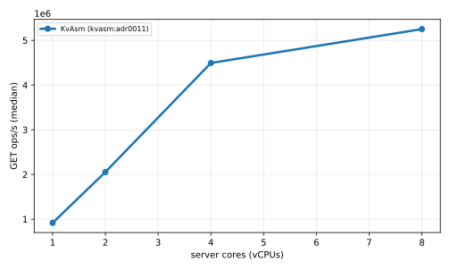

# KvAsm benchmark report

Profile **standard**, recorded 2026-11-15T13:35:41 UTC, repository revision `c1b0f67b0e2f`. Method: [METHODOLOGY.md](../../METHODOLOGY.md).

## Environment

- CPU: 13th Gen Intel(R) Core(TM) i9-13900K, 32 vCPUs seen by the container VM; Docker Desktop, kernel 5.15.153.1-microsoft-standard-WSL2
- Docker 27.3.1, cgroup v1 (cgroupfs), security options ['name=seccomp,profile=unconfined']
- Placement: server on vCPUs 0..N-1, kvbench on 16-31 with 16 threads, loopback in the server's network namespace
- CPU clock factor 1.0356 (cgroup CPU time per wall second on a known load; server CPU figures are divided by it)

| System | Image | Configuration |
|---|---|---|
| KvAsm (kvasm:adr0011) | `kvasm:adr0011` `fcce5d2fbbcf3160b22` | gRPC over h2c; one worker thread per core (KVASM_WORKERS). |
| Redis 8.10.2 | `redis:8.10.2` `426335161ea6c23f3b3` | Persistence off (--save '' --appendonly no); io-threads = tuned thread count (commands still execute on the main thread). |
| Valkey 9.1.2 | `valkey/valkey:9.1.2` `faa14c828e611eb9dfd` | Persistence off; io-threads = tuned thread count. 9.2 was only a release candidate at test time. |
| Dragonfly 2.0.0 | `ghcr.io/dragonflydb/dragonfly:v2.0.0` `9a0d5f8f474b3631233` | Snapshots off (--dbfilename=); proactor_threads = tuned thread count; memlock unlimited as its docs require; io_uring is available on this host (seccomp unconfined), so Dragonfly uses its preferred I/O engine. |
| Garnet 2.1.8 | `kvbench/garnet:2.1.8` `8a297dea4465e17cfcc` | Built from Microsoft's own Dockerfile at tag v2.1.8 (the newest published image, 2.1.0, is eight releases older; 'latest' is an unreleased main build). Defaults: AOF off; the .NET thread pool sizes itself from the cpuset, so there is no thread knob to tune. |
| Memcached 1.6.45 | `memcached:1.6.45` `3de3fa823e6482be4ad` | Meta protocol (mg/ms/mn); -t = tuned thread count; -m sized so nothing is evicted; UDP off. |

## Run validity

| Experiment | ok | invalid | failed |
|---|---|---|---|
| E0 | 18 | 0 | 0 |
| E1 | 24 | 0 | 0 |
| E2 | 3 | 0 | 0 |

Client-bound runs (client > 85% busy, server < 90%): 12
- `E0/kvasm/c8/t8/get100-v100-k1000000-uni-c64d16/r0`
- `E0/kvasm/c8/t7/get100-v100-k1000000-uni-c64d16/r0`
- `E0/kvasm/c8/t8/get100-v100-k1000000-uni-c64d16/r1`
- `E0/kvasm/c8/t7/get100-v100-k1000000-uni-c64d16/r1`
- `E0/kvasm/c8/t7/get100-v100-k1000000-uni-c64d16/r2`
- `E0/kvasm/c8/t8/get100-v100-k1000000-uni-c64d16/r2`
- `E1/kvasm/c8/t8/get100-v100-k1000000-uni-c64d16/r0`
- `E1/kvasm/c8/t8/get100-v100-k1000000-uni-c64d16/r1`
- `E1/kvasm/c8/t8/get100-v100-k1000000-uni-c64d16/r2`
- `E1/kvasm/c8/t8/get100-v100-k1000000-uni-c64d16/r3`
- `E1/kvasm/c8/t8/get100-v100-k1000000-uni-c64d16/r4`
- `E1/kvasm/c8/t8/get100-v100-k1000000-uni-c64d16/r5`

## Host interference

Before the first run, programs outside the container VM used **4.7 of 32 logical CPUs** (peak 5.6).

| Experiment | runs | median outside load (CPUs) | 90th percentile | max | runs above 2 |
|---|---|---|---|---|---|
| E0 | 18 | 6.7 | 9.8 | 10.7 | 18 |
| E1 | 24 | 8.1 | 13.9 | 14.1 | 24 |
| E2 | 3 | 6.0 | 6.2 | 6.2 | 3 |

**Effect:** Spearman ρ = -0.70 between outside load and each run's throughput relative to its cell's median (42 runs). Negative means outside load cost throughput; near zero means it did not measurably matter.

## E0 — Thread-count tuning

Median GET throughput for each thread setting; the better one (bold) is used by every later experiment.

| System | Cores | threads = N−1 | threads = N |
|---|---|---|---|
| KvAsm (kvasm:adr0011) | 2 | 936 k (902–937 k) | **2.22 M (1.84–2.39 M)** |
| KvAsm (kvasm:adr0011) | 4 | 3.74 M (3.17–3.75 M) | **4.45 M (4.35–4.66 M)** |
| KvAsm (kvasm:adr0011) | 8 | 5.05 M (5.05–5.28 M) | **5.33 M (3.75–5.50 M)** |

## E1 — Throughput scaling (100% GET, 100-byte values, 1M keys, uniform)

| Throughput (ops/s) | 1 core | 2 cores | 4 cores | 8 cores |
|---|---|---|---|---|
| KvAsm (kvasm:adr0011) | 918 k (911–949 k) | 2.05 M (1.96–2.39 M) | 4.49 M (4.20–4.69 M) | 5.25 M (5.09–5.41 M) |

**CPU efficiency** — operations per server CPU-second (higher is better):

| ops per CPU-second | 1 core | 2 cores | 4 cores | 8 cores |
|---|---|---|---|---|
| KvAsm (kvasm:adr0011) | 922 k (911–954 k) | 1.03 M (980–1.18 M) | 1.17 M (1.14–1.23 M) | 954 k (925–1.04 M) |

**Server CPU utilization** of its core budget (1.0 = all given cores busy; ▲ only means KvAsm kept more of its cores busy, which is neither good nor bad by itself):

| utilization | 1 core | 2 cores | 4 cores | 8 cores |
|---|---|---|---|---|
| KvAsm (kvasm:adr0011) | 1.00 (0.99–1.00) | 1.00 (1.00–1.01) | 0.96 (0.92–0.96) | 0.70 (0.61–0.71) |

**Memory per key** after preloading 1M keys (anonymous memory delta ÷ keys; 16-byte key + 100-byte value = 116 raw bytes; lower is better):

| bytes / key | all E1 runs |
|---|---|
| KvAsm (kvasm:adr0011) | 163 B (162–163 B) |

## E2 — Read/write mixes (4 cores)

100-byte values, 1M keys; Zipf uses YCSB's scrambled Zipfian with θ = 0.99.

| Throughput (ops/s) | 50% GET | 100% SET | 90% GET, Zipf 0.99 |
|---|---|---|---|
| KvAsm (kvasm:adr0011) | 3.81 M | 4.00 M | 4.48 M |

## S1 — Measurement stability

**Within runs** (per-second throughput samples, all 45 timed runs): median coefficient of variation 3.2%, 90th percentile 7.9%, worst 16.2%.

**Between runs** (fresh server each, E1 and S1 cells with ≥ 3 runs): median CV 3.1%, worst 7.6% (kvasm, 2 cores).

---

Legend: `median (min–max)` over repetitions, each with a fresh server. KvAsm ÷ X: ratio of medians, then either **sign** — [min–max of the per-block ratios] and the exact two-sided sign test over blocks (paired: both systems ran in the same block, so shared drift cancels) — or **MW** — [conservative range containing every pairwise run ratio] and the exact two-sided Mann–Whitney p (unpaired). ▲ KvAsm clearly better, ▼ clearly worse (p < 0.05; for MW also the range excludes 1), ≈ no clear difference. With 6 blocks, ▲/▼ means all six agree; cells with 3 repetitions are descriptive only — no test can reach p < 0.05 with them.
