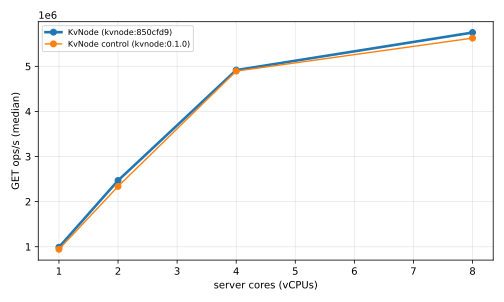
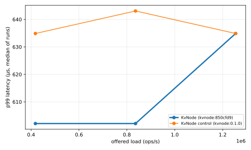
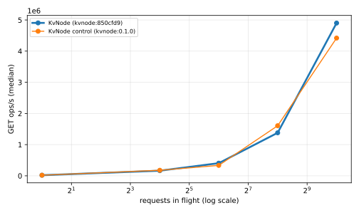

# KvNode benchmark report

Profile **standard**, recorded 2026-11-15T15:33:38 UTC, repository revision `5b1161df03b5`. Method: [METHODOLOGY.md](../../METHODOLOGY.md).

## Environment

- CPU: 13th Gen Intel(R) Core(TM) i9-13900K, 32 vCPUs seen by the container VM; Docker Desktop, kernel 5.15.153.1-microsoft-standard-WSL2
- Docker 27.3.1, cgroup v1 (cgroupfs), security options ['name=seccomp,profile=unconfined']
- Placement: server on vCPUs 0..N-1, kvbench on 16-31 with 16 threads, loopback in the server's network namespace
- CPU clock factor 1.0457 (cgroup CPU time per wall second on a known load; server CPU figures are divided by it)

| System | Image | Configuration |
|---|---|---|
| KvNode (kvnode:850cfd9) | `kvnode:850cfd9` `b8833cf7eda0f3f00bb` | gRPC over h2c; one worker thread per core (KVNODE_WORKERS). |
| Redis 8.10.2 | `redis:8.10.2` `426335161ea6c23f3b3` | Persistence off (--save '' --appendonly no); io-threads = tuned thread count (commands still execute on the main thread). |
| Valkey 9.1.2 | `valkey/valkey:9.1.2` `faa14c828e611eb9dfd` | Persistence off; io-threads = tuned thread count. 9.2 was only a release candidate at test time. |
| Dragonfly 2.0.0 | `ghcr.io/dragonflydb/dragonfly:v2.0.0` `9a0d5f8f474b3631233` | Snapshots off (--dbfilename=); proactor_threads = tuned thread count; memlock unlimited as its docs require; io_uring is available on this host (seccomp unconfined), so Dragonfly uses its preferred I/O engine. |
| Garnet 2.1.8 | `kvbench/garnet:2.1.8` `8a297dea4465e17cfcc` | Built from Microsoft's own Dockerfile at tag v2.1.8 (the newest published image, 2.1.0, is eight releases older; 'latest' is an unreleased main build). Defaults: AOF off; the .NET thread pool sizes itself from the cpuset, so there is no thread knob to tune. |
| Memcached 1.6.45 | `memcached:1.6.45` `3de3fa823e6482be4ad` | Meta protocol (mg/ms/mn); -t = tuned thread count; -m sized so nothing is evicted; UDP off. |

## Run validity

| Experiment | ok | invalid | failed |
|---|---|---|---|
| E0 | 36 | 0 | 0 |
| E1 | 48 | 0 | 0 |
| E2 | 48 | 0 | 0 |
| E3 | 12 | 0 | 0 |
| E4 | 18 | 0 | 0 |
| E5 | 12 | 0 | 0 |
| E6 | 12 | 0 | 0 |
| E7 | 30 | 0 | 0 |
| E8 | 12 | 0 | 0 |
| N1 | 12 | 0 | 0 |
| N3 | 12 | 0 | 0 |
| S1 | 20 | 0 | 0 |

Client-bound runs (client > 85% busy, server < 90%): 24
- `E0/kvnode/c8/t8/get100-v100-k1000000-uni-c64d16/r0`
- `E0/kvnode-control/c8/t8/get100-v100-k1000000-uni-c64d16/r0`
- `E0/kvnode-control/c8/t7/get100-v100-k1000000-uni-c64d16/r0`
- `E0/kvnode/c8/t7/get100-v100-k1000000-uni-c64d16/r0`
- `E0/kvnode/c8/t7/get100-v100-k1000000-uni-c64d16/r1`
- `E0/kvnode-control/c8/t8/get100-v100-k1000000-uni-c64d16/r1`
- `E0/kvnode-control/c8/t7/get100-v100-k1000000-uni-c64d16/r1`
- `E0/kvnode/c8/t8/get100-v100-k1000000-uni-c64d16/r1`
- `E0/kvnode/c8/t8/get100-v100-k1000000-uni-c64d16/r2`
- `E0/kvnode/c8/t7/get100-v100-k1000000-uni-c64d16/r2`
- `E0/kvnode-control/c8/t8/get100-v100-k1000000-uni-c64d16/r2`
- `E0/kvnode-control/c8/t7/get100-v100-k1000000-uni-c64d16/r2`
- `E1/kvnode-control/c8/t8/get100-v100-k1000000-uni-c64d16/r0`
- `E1/kvnode/c8/t8/get100-v100-k1000000-uni-c64d16/r0`
- `E1/kvnode/c8/t8/get100-v100-k1000000-uni-c64d16/r1`
- `E1/kvnode-control/c8/t8/get100-v100-k1000000-uni-c64d16/r1`
- `E1/kvnode/c8/t8/get100-v100-k1000000-uni-c64d16/r2`
- `E1/kvnode-control/c8/t8/get100-v100-k1000000-uni-c64d16/r2`
- `E1/kvnode/c8/t8/get100-v100-k1000000-uni-c64d16/r3`
- `E1/kvnode-control/c8/t8/get100-v100-k1000000-uni-c64d16/r3`
- `E1/kvnode/c8/t8/get100-v100-k1000000-uni-c64d16/r4`
- `E1/kvnode-control/c8/t8/get100-v100-k1000000-uni-c64d16/r4`
- `E1/kvnode-control/c8/t8/get100-v100-k1000000-uni-c64d16/r5`
- `E1/kvnode/c8/t8/get100-v100-k1000000-uni-c64d16/r5`

## Host interference

Before the first run, programs outside the container VM used **5.6 of 32 logical CPUs** (peak 8.1).

| Experiment | runs | median outside load (CPUs) | 90th percentile | max | runs above 2 |
|---|---|---|---|---|---|
| E0 | 36 | 4.4 | 6.9 | 9.9 | 36 |
| E1 | 48 | 4.0 | 4.9 | 7.6 | 48 |
| E2 | 48 | 4.4 | 6.3 | 8.7 | 48 |
| E3 | 12 | 4.5 | 6.2 | 6.3 | 12 |
| E4 | 18 | 4.6 | 7.9 | 8.3 | 18 |
| E5 | 12 | 3.4 | 4.1 | 4.1 | 12 |
| E6 | 12 | 4.9 | 8.0 | 8.6 | 12 |
| E7 | 30 | 6.4 | 13.5 | 15.1 | 30 |
| N1 | 12 | 3.6 | 7.3 | 7.7 | 12 |
| N3 | 12 | 3.6 | 7.0 | 8.1 | 12 |
| S1 | 20 | 5.0 | 9.2 | 10.0 | 20 |

**Effect:** Spearman ρ = -0.25 between outside load and each run's throughput relative to its cell's median (242 runs). Negative means outside load cost throughput; near zero means it did not measurably matter.

**Quiet-only check** (declared in advance): 0 of 81 KvNode-vs-other pairs had at most 2 CPUs of outside load on both runs, too few to recompute anything.

**Adjusted to equal outside load.** Each experiment's pairs are corrected with one common slope of log(KvNode ÷ X) on the difference in outside load between the two runs of a block, estimated within comparisons (analysis of covariance). The slope column gives the change of the ratio per logical CPU of extra outside load on KvNode's run. Raw, unadjusted results are the tables in each section below. Where the two disagree, the difference is load, not the servers.

| Experiment · cell | slope |  |
|---|---|
| E1 · 1 core | -1.2% |  |
| E1 · 2 cores | -1.2% |  |
| E1 · 4 cores | -1.2% |  |
| E1 · 8 cores | -1.2% |  |
| E2 · 90% GET | -1.1% |  |
| E2 · 90% GET, Zipf | -1.1% |  |
| E2 · 50% GET | -1.1% |  |
| E2 · 100% SET | -1.1% |  |
| E3 · 256×1 | -5.0% |  |
| E5 · no-op | -5.3% |  |
| E6 · 1024 B values | -1.9% |  |
| E6 · 16384 B values | -1.9% |  |
| E7 · 1×1 | -1.0% |  |
| E7 · 16×1 | -1.0% |  |
| E7 · 64×1 | -1.0% |  |
| E7 · 64×4 | -1.0% |  |
| E7 · 64×16 | -1.0% |  |

## E0 — Thread-count tuning

Median GET throughput for each thread setting; the better one (bold) is used by every later experiment.

| System | Cores | threads = N−1 | threads = N |
|---|---|---|---|
| KvNode (kvnode:850cfd9) | 2 | 971 k (967–984 k) | **2.49 M (2.44–2.53 M)** |
| KvNode (kvnode:850cfd9) | 4 | 4.05 M (3.83–4.57 M) | **4.89 M (4.87–4.99 M)** |
| KvNode (kvnode:850cfd9) | 8 | 5.43 M (5.38–5.51 M) | **5.76 M (5.75–5.81 M)** |
| KvNode control (kvnode:0.1.0) | 2 | 994 k (928–995 k) | **2.43 M (2.33–2.46 M)** |
| KvNode control (kvnode:0.1.0) | 4 | 3.99 M (3.92–4.04 M) | **4.82 M (4.82–4.91 M)** |
| KvNode control (kvnode:0.1.0) | 8 | 5.36 M (5.24–5.45 M) | **5.53 M (5.45–5.56 M)** |

## E1 — Throughput scaling (100% GET, 100-byte values, 1M keys, uniform)

| Throughput (ops/s) | 1 core | 2 cores | 4 cores | 8 cores |
|---|---|---|---|---|
| KvNode (kvnode:850cfd9) | 989 k (953–1.07 M) | 2.47 M (2.38–2.65 M) | 4.92 M (4.73–4.99 M) | 5.75 M (5.54–5.91 M) |
| KvNode control (kvnode:0.1.0) | 943 k (926–1.01 M) | 2.34 M (2.26–2.53 M) | 4.89 M (4.76–4.98 M) | 5.63 M (5.41–5.76 M) |
| *KvNode ÷ KvNode* | 1.05× [1.02–1.09] sign p=0.031 ▲ | 1.06× [0.95–1.13] sign p=0.219 ≈ | 1.00× [0.96–1.05] sign p=1.000 ≈ | 1.02× [0.99–1.08] sign p=0.219 ≈ |

**CPU efficiency** — operations per server CPU-second (higher is better):

| ops per CPU-second | 1 core | 2 cores | 4 cores | 8 cores |
|---|---|---|---|---|
| KvNode (kvnode:850cfd9) | 993 k (952–1.06 M) | 1.23 M (1.19–1.32 M) | 1.32 M (1.26–1.35 M) | 1.05 M (1.00–1.08 M) |
| KvNode control (kvnode:0.1.0) | 946 k (922–1.01 M) | 1.17 M (1.13–1.26 M) | 1.28 M (1.25–1.30 M) | 963 k (944–991 k) |
| *KvNode ÷ KvNode* | 1.05× [1.02–1.09] sign p=0.031 ▲ | 1.05× [0.95–1.12] sign p=0.219 ≈ | 1.03× [0.98–1.08] sign p=0.219 ≈ | 1.09× [1.05–1.14] sign p=0.031 ▲ |

**Server CPU utilization** of its core budget (1.0 = all given cores busy; ▲ only means KvNode kept more of its cores busy, which is neither good nor bad by itself):

| utilization | 1 core | 2 cores | 4 cores | 8 cores |
|---|---|---|---|---|
| KvNode (kvnode:850cfd9) | 1.00 (0.99–1.01) | 1.00 (1.00–1.00) | 0.93 (0.93–0.94) | 0.69 (0.68–0.70) |
| KvNode control (kvnode:0.1.0) | 1.00 (0.99–1.00) | 1.00 (1.00–1.00) | 0.96 (0.95–0.96) | 0.73 (0.72–0.74) |
| *KvNode ÷ KvNode* | 1.00× [0.99–1.01] sign p=1.000 ≈ | 1.00× [1.00–1.01] sign p=0.219 ≈ | 0.97× [0.97–0.98] sign p=0.031 ▼ | 0.94× [0.92–0.96] sign p=0.031 ▼ |

**Memory per key** after preloading 1M keys (anonymous memory delta ÷ keys; 16-byte key + 100-byte value = 116 raw bytes; lower is better):

| bytes / key | all E1 runs |
|---|---|
| KvNode (kvnode:850cfd9) | 163 B (162–163 B) |
| KvNode control (kvnode:0.1.0) | 163 B (162–163 B) |
| *KvNode ÷ KvNode* | 1.00× [1.00–1.00] sign p=0.023 ▲ |

## E2 — Read/write mixes (4 cores)

100-byte values, 1M keys; Zipf uses YCSB's scrambled Zipfian with θ = 0.99.

| Throughput (ops/s) | 90% GET | 50% GET | 100% SET | 90% GET, Zipf 0.99 |
|---|---|---|---|---|
| KvNode (kvnode:850cfd9) | 4.71 M (4.58–4.99 M) | 4.28 M (4.06–4.45 M) | 4.43 M (3.94–4.60 M) | 4.76 M (4.60–4.85 M) |
| KvNode control (kvnode:0.1.0) | 4.48 M (4.31–4.59 M) | 2.28 M (2.19–2.36 M) | 1.41 M (1.39–1.44 M) | 4.40 M (4.09–4.51 M) |
| *KvNode ÷ KvNode* | 1.05× [1.00–1.12] sign p=0.219 ≈ | 1.88× [1.84–1.91] sign p=0.031 ▲ | 3.14× [2.77–3.31] sign p=0.031 ▲ | 1.08× [1.05–1.14] sign p=0.031 ▲ |

## E3 — No pipelining (256 connections × 1 request in flight, 4 cores)

| metric | ops/s | p50 µs | p99 µs |
|---|---|---|---|
| KvNode (kvnode:850cfd9) | 505,799 (462,688–537,624) | 452.6 (428.0–501.8) | 1,212 (1,139–1,352) |
| KvNode control (kvnode:0.1.0) | 502,750 (480,961–531,115) | 454.7 (428.0–477.2) | 1,212 (1,155–1,270) |
| *KvNode ÷ KvNode* | 1.01× [0.90–1.11] sign p=0.688 ≈ | 1.00× [0.91–1.11] sign p=0.688 ≈ | 1.00× [0.90–1.12] sign p=1.000 ≈ |

## E4 — Latency at identical offered load (open loop, Poisson, 4 cores)

Latency is measured from each request's intended send time, so queueing behind a slow response counts (no coordinated omission). Lower is better.

**p50 latency (µs)**

| p50 | 418 k/s | 836 k/s | 1.25 M/s |
|---|---|---|---|
| KvNode (kvnode:850cfd9) | 152.6 (152.6–152.6) | 197.6 (195.6–197.6) | 222.2 (201.7–238.6) |
| KvNode control (kvnode:0.1.0) | 162.8 (152.6–177.2) | 179.2 (175.1–187.4) | 218.1 (214.0–220.2) |
| *KvNode ÷ KvNode* | 0.94× [0.86–1.00] sign p=0.500 ≈ | 1.10× [1.05–1.13] sign p=0.250 ≈ | 1.02× [0.94–1.08] sign p=1.000 ≈ |

**p99 latency (µs)**

| p99 | 418 k/s | 836 k/s | 1.25 M/s |
|---|---|---|---|
| KvNode (kvnode:850cfd9) | 602.1 (577.5–634.9) | 602.1 (593.9–798.7) | 634.9 (610.3–716.8) |
| KvNode control (kvnode:0.1.0) | 634.9 (626.7–675.8) | 643.1 (634.9–659.5) | 634.9 (626.7–651.3) |
| *KvNode ÷ KvNode* | 0.95× [0.89–1.00] sign p=0.500 ≈ | 0.94× [0.92–1.21] sign p=1.000 ≈ | 1.00× [0.97–1.13] sign p=1.000 ≈ |

**p999 latency (µs)**

| p999 | 418 k/s | 836 k/s | 1.25 M/s |
|---|---|---|---|
| KvNode (kvnode:850cfd9) | 897.0 (872.5–1155.1) | 1011.7 (872.5–1482.8) | 946.2 (938.0–1318.9) |
| KvNode control (kvnode:0.1.0) | 1019.9 (1003.5–2179.1) | 921.6 (888.8–1073.2) | 995.3 (978.9–1237.0) |
| *KvNode ÷ KvNode* | 0.88× [0.41–1.13] sign p=1.000 ≈ | 1.10× [0.98–1.38] sign p=1.000 ≈ | 0.95× [0.76–1.33] sign p=1.000 ≈ |

Achieved throughput (should equal the offered load when the system keeps up):

| achieved | 418 k/s | 836 k/s | 1.25 M/s |
|---|---|---|---|
| KvNode (kvnode:850cfd9) | 418 k (418–418 k) | 836 k (836–836 k) | 1.25 M (1.25–1.25 M) |
| KvNode control (kvnode:0.1.0) | 418 k (418–418 k) | 836 k (836–836 k) | 1.25 M (1.25–1.25 M) |
| *KvNode ÷ KvNode* | 1.00× [1.00–1.00] sign p=1.000 ≈ | 1.00× [1.00–1.00] sign p=1.000 ≈ | 1.00× [1.00–1.00] sign p=1.000 ≈ |

## E5 — Per-request floor (no-op round trip, 1 core)

RESP `PING`, memcached meta `mn`, gRPC `grpc.health.v1.Health/Check`: the cost of protocol, framing and event loop without any data access.

| metric | ops/s | server CPU ns/op |
|---|---|---|
| KvNode (kvnode:850cfd9) | 1.21 M (1.18–1.23 M) | 835 (810–852) |
| KvNode control (kvnode:0.1.0) | 1.21 M (1.10–1.23 M) | 834 (815–915) |
| *KvNode ÷ KvNode* | 1.00× [0.97–1.12] sign p=1.000 ≈ | 1.00× [0.89–1.03] sign p=1.000 ≈ |

## E6 — Value size (4 cores, 100% GET, about 1 GiB of data)

| Throughput (ops/s) | 1024 B values | 16384 B values |
|---|---|---|
| KvNode (kvnode:850cfd9) | 3.84 M (3.53–3.84 M) | 646 k (625–655 k) |
| KvNode control (kvnode:0.1.0) | 3.50 M (3.50–3.69 M) | 357 k (335–373 k) |
| *KvNode ÷ KvNode* | 1.10× [1.01–1.10] sign p=0.250 ≈ | 1.81× [1.75–1.93] sign p=0.250 ≈ |

Memory per key (lower is better):

| bytes / key | 1024 B | 16384 B |
|---|---|---|
| KvNode (kvnode:850cfd9) | 1,075 B (1,075–1,075 B) | 18,438 B (18,435–18,439 B) |
| KvNode control (kvnode:0.1.0) | 1,075 B (1,075–1,075 B) | 16,515 B (16,515–16,515 B) |
| *KvNode ÷ KvNode* | 1.00× [1.00–1.00] sign p=1.000 ≈ | 1.12× [1.12–1.12] sign p=0.250 ≈ |

## E7 — Concurrency sweep (4 cores, 100% GET)

Requests in flight = connections × depth. At 1 in flight the throughput is exactly 1 / round-trip time; beyond that, each system shows how far concurrency carries it.

| Throughput (ops/s) | 1×1 = 1 | 16×1 = 16 | 64×1 = 64 | 64×4 = 256 | 64×16 = 1024 |
|---|---|---|---|---|---|
| KvNode (kvnode:850cfd9) | 19 k (17–19 k) | 164 k (146–171 k) | 405 k (360–407 k) | 1.38 M (1.31–1.50 M) | 4.90 M (4.84–5.17 M) |
| KvNode control (kvnode:0.1.0) | 19 k (18–19 k) | 177 k (174–185 k) | 334 k (324–379 k) | 1.61 M (1.57–1.61 M) | 4.42 M (4.30–4.70 M) |
| *KvNode ÷ KvNode* | 1.02× [0.90–1.03] sign p=1.000 ≈ | 0.93× [0.83–0.99] sign p=0.250 ≈ | 1.21× [1.07–1.21] sign p=0.250 ≈ | 0.86× [0.81–0.95] sign p=0.250 ≈ | 1.11× [1.10–1.13] sign p=0.250 ≈ |

Median latency (µs; closed loop, so it grows with the queue by Little's law):

| p50 µs | 1 in flight | 16 in flight | 64 in flight | 256 in flight | 1024 in flight |
|---|---|---|---|---|---|
| KvNode (kvnode:850cfd9) | 48.4 (47.4–50.4) | 86.5 (81.4–99.8) | 140.3 (138.2–154.6) | 160.8 (146.4–173.1) | 160.8 (152.6–160.8) |
| KvNode control (kvnode:0.1.0) | 47.9 (47.4–48.4) | 77.3 (74.2–80.4) | 156.7 (150.5–171.0) | 142.3 (140.3–144.4) | 191.5 (173.1–193.5) |
| *KvNode ÷ KvNode* | 1.01× [0.99–1.06] sign p=1.000 ≈ | 1.12× [1.01–1.29] sign p=0.250 ≈ | 0.90× [0.90–0.92] sign p=0.250 ≈ | 1.13× [1.01–1.23] sign p=0.250 ≈ | 0.84× [0.83–0.88] sign p=0.250 ≈ |

## E8 — Client validation (kvbench vs each ecosystem's standard tool, 4 cores)

If kvbench reaches at least the throughput of the standard tool on the same server and workload, it does not handicap that system.

| Server | Tool / keys | Throughput (ops/s) |
|---|---|---|
| KvNode (kvnode:850cfd9) | h2load-onekey | 3.25 M (3.20–3.30 M) |
| KvNode (kvnode:850cfd9) | kvbench-onekey | 5.11 M (5.08–5.22 M) |
| KvNode control (kvnode:0.1.0) | h2load-onekey | 3.25 M (3.19–3.26 M) |
| KvNode control (kvnode:0.1.0) | kvbench-onekey | 4.99 M (4.87–5.14 M) |

- KvNode (kvnode:850cfd9): kvbench ÷ h2load = 1.57× [1.54–1.63] sign p=0.250 ≈

## N — one core: KvNode vs Redis and Valkey

E1's and E5's 1-core cells for the single-threaded-execution servers, run on their own so the headline is re-checked with full pairing. Ratios are KvNode ÷ X, paired by block.

### N1 — 1 core, E1's workload (100% GET, 100-byte values, 1M keys, 64×16)

| metric | ops/s | ops per CPU-second | server CPU ns/op | p50 µs | p99 µs |
|---|---|---|---|---|---|
| KvNode (kvnode:850cfd9) | 1.01 M (960–1.05 M) | 1.01 M (949–1.04 M) | 993 (958–1054) | 958 (905–1004) | 2015 (1925–2089) |
| KvNode control (kvnode:0.1.0) | 957 k (913–1.00 M) | 954 k (907–995 k) | 1049 (1005–1102) | 1004 (954–1057) | 2114 (2023–2212) |
| *KvNode ÷ KvNode* | 1.06× [1.02–1.12] sign p=0.031 ▲ | 1.06× [1.02–1.12] sign p=0.031 ▲ | 0.95× [0.89–0.98] sign p=0.031 ▲ | 0.96× [0.90–1.00] sign p=0.062 ≈ | 0.95× [0.89–0.99] sign p=0.031 ▲ |

### N3 — per-request floor (no-op round trip, 1 core)

| metric | ops/s | server CPU ns/op |
|---|---|---|
| KvNode (kvnode:850cfd9) | 1.13 M (1.06–1.20 M) | 887 (841–943) |
| KvNode control (kvnode:0.1.0) | 1.17 M (1.10–1.23 M) | 854 (818–913) |
| *KvNode ÷ KvNode* | 0.96× [0.94–0.99] sign p=0.031 ▼ | 1.04× [1.01–1.06] sign p=0.031 ▼ |

## S1 — Measurement stability

**Within runs** (per-second throughput samples, all 260 timed runs): median coefficient of variation 3.1%, 90th percentile 5.8%, worst 16.2%.

**Between runs** (fresh server each, E1 and S1 cells with ≥ 3 runs): median CV 3.2%, worst 4.2% (kvnode-control, 4 cores).

| System | runs | median ops/s | between-run CV | median within-run CV | worst 1-s sample ÷ mean | median trend per 10 s | S1 ÷ E1 (same cell, hours apart) |
|---|---|---|---|---|---|---|---|
| KvNode (kvnode:850cfd9) | 10 | 4.84 M | 3.5% | 3.4% | 0.88 | +0.2% | 0.98× [0.89–1.06] MW p=0.263 ≈ |
| KvNode control (kvnode:0.1.0) | 10 | 4.73 M | 4.2% | 3.9% | 0.59 | +0.7% | 0.97× [0.89–1.06] MW p=0.118 ≈ |

Reading guide: a between-run CV of a few percent means a single run is representative to within that margin; differences between systems smaller than the CVs involved are noise. The S1 ÷ E1 column should be ≈ 1.00 (≈): the same cell measured at the start and the end of the session.

---

Legend: `median (min–max)` over repetitions, each with a fresh server. KvNode ÷ X: ratio of medians, then either **sign** — [min–max of the per-block ratios] and the exact two-sided sign test over blocks (paired: both systems ran in the same block, so shared drift cancels) — or **MW** — [conservative range containing every pairwise run ratio] and the exact two-sided Mann–Whitney p (unpaired). ▲ KvNode clearly better, ▼ clearly worse (p < 0.05; for MW also the range excludes 1), ≈ no clear difference. With 6 blocks, ▲/▼ means all six agree; cells with 3 repetitions are descriptive only — no test can reach p < 0.05 with them.
