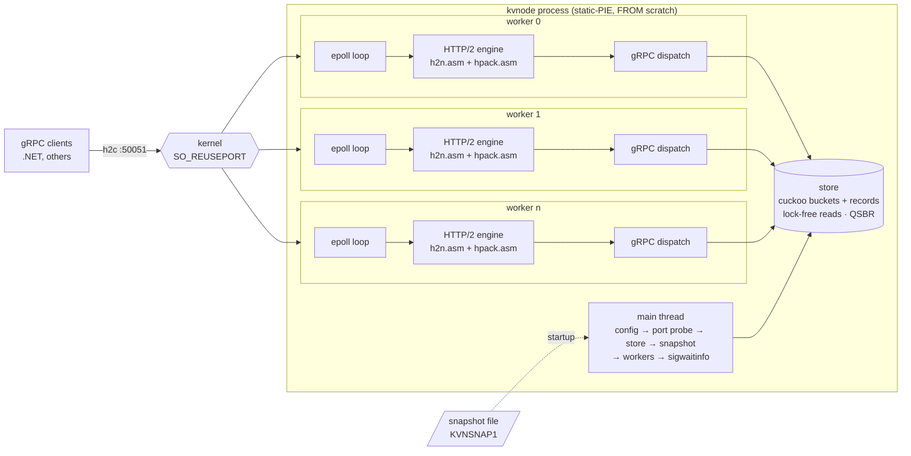
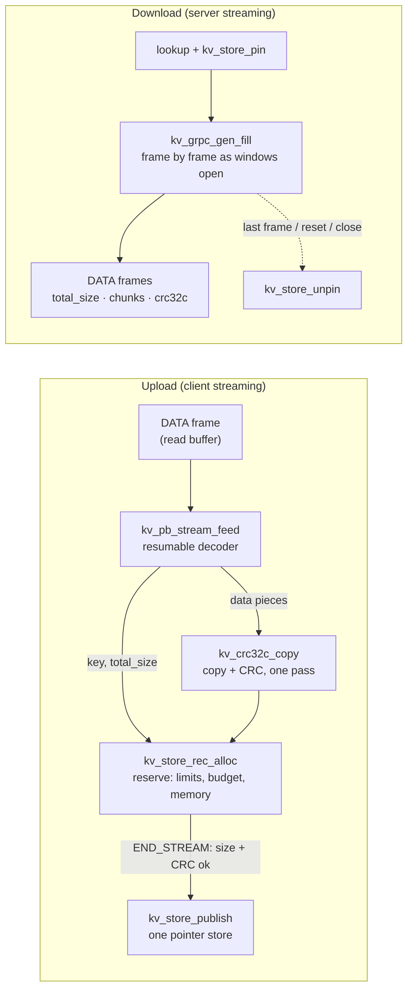

# KvNode architecture

KvNode is a gRPC key-value server written in x86-64 assembly (NASM). It
links one C library, glibc. HTTP/2 is KvNode's own engine, `h2n.asm` with
the HPACK decoder `hpack.asm` (ADR 0007). nghttp2, the library it replaced,
was removed from the server (ADR 0008) and survives only as the independent
client the tests and benchmarks check the server with. This page shows how
the parts fit together. The ADRs record why each choice was made.

## Request path

1. **Accept.** The kernel hashes a new connection to one worker's
   `SO_REUSEPORT` listener. The connection stays on that thread for life,
   so connection state needs no locks.
2. **Read.** The worker's `epoll` loop hands the connection to the HTTP/2
   engine (`h2n.asm`), which reads up to 256 KiB (`READ_CHUNK`: measured
   against 64 KiB-1 MiB, [ADR 0010](adr/0010-streaming-upload-download.md)),
   parses frames, applies
   HPACK and flow control and enforces stream limits. Frames are parsed in
   place in the read buffer, and a partial frame is carried to the next
   read. Header blocks are decoded by `hpack.asm`, whose per-field
   *meanings* (computed once per distinct field) replace string
   comparisons; a block byte-identical to the connection's previous one
   under the same HPACK table replays that decode instead. Streams live in
   an open-addressing map, and every RFC 9113 state and error rule is
   applied (h2spec 146/146).
3. **Route.** Headers decide the route: `:path` picks
   `/kvnode.v1.KvNode/{Get,Put,Delete,Upload,Download}` or
   `/grpc.health.v1.Health/Check`, and `:method`, `content-type` and
   `grpc-encoding` are checked. The body is buffered per stream within two
   budgets: the per-request `max_request` and the per-connection
   `KVNODE_CONN_BUFFER_MB`; a body that arrives whole in one DATA frame is
   used in place instead. An **Upload** body is never buffered: every DATA
   payload goes to the streaming decoder as it arrives (see
   [Streaming calls](#streaming-calls-adr-0010)).
4. **Execute.** At END_STREAM the worker validates the 5-byte gRPC framing,
   decodes the protobuf (zero-copy, `proto.asm`), checks limits and hashes
   the key (SipHash-2-4-128, secret key).
   - Puts, Deletes and health checks execute right there.
   - **GETs are deferred:** their two candidate buckets are prefetched
     immediately, and the stream joins the connection's batch.
   - When the whole read has been parsed, `kv_grpc_run_batch` runs two
     passes over the batch: prefetch the first three cache lines of each
     candidate record, then look up and answer. The cache misses of up to a
     whole read's GETs thus overlap instead of stalling one after another
     (ADR 0005: +28% at 4 cores and +35% at 1 core, paired medians; the
     third line covers a whole record of up to 144 bytes, so the value copy
     no longer waits on DRAM).
   - A GET the peer resets within the same read is freed, not answered.
5. **Respond.** HEADERS, then DATA (the message, within the peer's
   flow-control windows), then trailer HEADERS (`grpc-status: 0`). Errors
   are a single Trailers-Only HEADERS frame.
   - Responses are framed straight into the output buffer, with
     precomputed header blocks: after a connection's first response,
     HEADERS carry 2 bytes and the trailers 1 byte. A GET hit is copied
     from the store record into its DATA frame, with no response buffer and
     no allocation.
   - **Nothing is sent until the whole epoll batch has been read**
     (ADR 0009). The worker processes every ready connection first, then
     flushes them all back to back, one `sendto` each. A client thread with
     several connections is woken once per batch instead of once per
     connection. Measured on one core: +26% GET/s with 8 connections per
     client thread, +12% with 4, +4% with 1, and lower p50 and p99 in every
     case.

The loop is event-driven and never spins. A connection is a state machine
resumed by epoll readiness (what C# async/await compiles to, without heap
continuations or thread hand-offs), and an idle worker sleeps in
`epoll_wait`. Measured: 4 workers holding 1,000 idle connections used 10 ms
of CPU in 10 s.

**Why an event-driven server still shows wakeup costs:**

- **A sleeping thread cannot "enter the action" by itself.** When its
  event arrives, the kernel must make it runnable and, if its CPU is idle,
  interrupt that CPU. That is the price of sleeping instead of spinning.
- **Under load a KvNode worker never sleeps** (0.00 wakeups per 1,000
  requests, measured). Each `epoll_wait` returns the next batch at once.
- **The wakeups in a loopback profile are the client's.** Its threads
  sleep between responses. With no network card in between, our `sendto`
  runs the client socket's receive path on our CPU, and ends by waking the
  client thread.
- **Remote clients** are woken by their own NIC on their own machine,
  where this cost never reaches the server.

The measurements are in `benchmarks/results/2026-09-27-second-pass`.

Allocation on this path goes through the worker's own pool (`pool.asm`):
streams, stream maps, HPACK rings and entries, and every request buffer. A
connection never leaves its worker thread, so the pool needs no locks.
Freed blocks are reused LIFO while still cached. Memory use, measured, is
in [OPERATIONS.md](OPERATIONS.md#memory).

**Fairness.** One connection's flush writes at most `FLUSH_BUDGET` (256 KiB)
per pass; with output still pending it keeps both EPOLLIN and EPOLLOUT
interest and yields to the worker's other connections. A bulk Download
therefore cannot monopolize its worker: measured with one worker, unary
Gets beside 32 MiB downloads stayed at 0.03 ms mean and 0.2–0.6 ms worst
(about 3 ms worst without the budget).

## Streaming calls (ADR 0010)

- **Upload.** `kv_grpc_upload_data` receives each non-empty DATA payload of
  an Upload the moment h2n has accounted it for flow control, and feeds it
  to `kv_pb_stream_feed` (`proto.asm`, state in `pbstream.inc`): a decoder
  resumable at every byte, which reports fields as events and hands data
  payloads over as pointers into the frame. The first message's `key` and
  `total_size` reserve the final record (`kv_store_rec_alloc`: the upload
  limit, the connection's budget `Conn.up_bytes ≤ KVNODE_CONN_BUFFER_MB`,
  the store's memory limit); every data piece is then copied straight into
  that record with its CRC-32C computed in the same pass
  (`kv_crc32c_copy`). At END_STREAM `upload_finish` checks whole messages,
  the exact size and the checksum, and `kv_store_publish` inserts the
  record or replaces the old one with one pointer store under the writer
  mutex. Any refusal is answered at once (Trailers-Only, then
  `RST_STREAM(NO_ERROR)` from `response_done`); a reset, a closed connection
  or the idle timeout frees the unpublished record (`kv_store_rec_free`)
  and returns its reservation. The value is copied once, and nothing is
  buffered per stream but the decoder's 64 bytes.
- **Download.** `download_start` looks the key up and **pins** the record
  (`kv_store_pin`) before the worker's next quiescent state, so the record
  stays readable for the whole call whatever writers do. The response body
  is **generated**: the stream is marked `ST_GEN` with its exact length
  (`download_body_len`), and each DATA frame's payload is produced in place
  by `kv_grpc_gen_fill` — message heads, value bytes (copied from the record
  and checksummed in the same pass) and the final CRC tail — as the peer's
  windows and the output buffer allow. A frame boundary can fall anywhere,
  inside a head or the CRC tail; the state lives in the stream's `Xfer`. The
  pin is dropped when the stream is freed: after its last frame, on reset,
  on connection close.
- **Pins and reclamation.** Pins live in a small open-addressing table
  beside the store, updated under the writer mutex (a Download pins and
  unpins once each). Reclamation consults it only while a pin exists: a
  retired record whose grace period ended but that is still pinned is
  marked deferred instead of freed, and the last `kv_store_unpin` frees it.
  Its bytes stay counted in `mem_used` until then, so a pinned 64 MiB
  record keeps holding 64 MiB of `KVNODE_MAX_MEMORY_MB`.
- **CRC-32C** (`crc32c.asm`), fused with the copy that moves the bytes
  anyway (an upload chunk into its record, a download chunk into the
  output buffer). Four paths, the fastest the CPU has chosen at startup
  (`KVNODE_CRC32C` forces one): carry-less folding on eight 128-bit lanes
  held in four 256-bit registers (VPCLMULQDQ + AVX2) or eight SSE registers
  (PCLMULQDQ), the `crc32` instruction, and slicing-by-8 tables; NASM
  computes the tables and the fold constants at assembly time. On a 16 KiB
  chunk in cache: ~88, ~45, ~15 and ~3.2 GB/s. A large upload's record is
  written with non-temporal stores (`kv_crc32c_copy_nt`, uploads of 64 KiB
  and more): its lines are cold and not read soon, so skipping the
  read-for-ownership doubles that copy (2.4x measured), and the cache keeps
  what is used again.
- **Idle timeout and stalled transfers.** Bytes the server manages to send
  count as activity, so a long Download whose client never needs to speak is
  not cut. A peer that stops reading at the TCP level is different: the idle
  GOAWAY cannot leave the full socket, so on the next expiry with no byte
  moved the connection is destroyed outright (`CONN_IDLE_CLOSING`),
  releasing its pins and reservations.

## Store (ADR 0001, ADR 0003)

- **Table:** 2^k buckets × 64 bytes. Each bucket holds a version word, six
  8-bit tags and six record pointers. It is sized once from
  `KVNODE_CAPACITY` at up to about 83% load and backed by `mmap`
  (`MAP_NORESERVE`, `MADV_HUGEPAGE`). Each whole 2 MiB region is faulted in
  with a write at startup: left to the lookups, a region's first touch was a
  read that mapped the huge zero page, and the first insert split it into
  4 KiB pages (measured: no huge page at all in a full 16 MiB table).
- **Lookup:** tag = the top byte of h2; bucket 1 comes from h1; bucket 2 =
  bucket 1 XOR a hash of the tag. By default one SSE2 compare matches the
  tags of both buckets (12 slots); `KVNODE_SCAN=swar` compares one bucket's
  six tags per 64-bit SWAR step instead. The full key is compared exactly
  on a tag hit. At most two cache lines are touched (ADR 0006).
- **Private caches (optional, off by default):** each worker can keep a
  two-level, direct-mapped cache of record pointers
  (`KVNODE_CACHE_L1_BITS`/`L2_BITS`). It is validated against per-key
  invalidation generations that writers bump before retiring a record.
  Measured slower than the CPU's own caches except for tiny hot sets
  (ADR 0006).
- **Insert:** use a free slot in either bucket, or else a bounded BFS (at
  most 256 nodes) finds a displacement path. Moves go backwards, copy first
  and clear second, with bucket versions odd, so a concurrent reader either
  sees the key or retries.
- **Records** are immutable: a 24-byte header, the key padded to 8 bytes,
  then the value. Put allocates and fills the new record outside the writer
  lock and publishes it with one pointer store. Upload uses the same record
  in two steps — reserved (`kv_store_rec_alloc`), filled chunk by chunk,
  then published (`kv_store_publish`) — so a record is still written once
  and never changes after it becomes visible.
- **Reclamation:** old records go to a limbo list stamped with a global
  epoch. They are freed once every online worker has announced a quiescent
  state since then (QSBR). A worker announces between event batches and is
  offline while it blocks in `epoll_wait`. A record pinned by a Download is
  deferred to its last unpin instead.

## Lifecycle

- **Startup** fails fast, in order: settings (exit 2 on any invalid value),
  port probe (refuses to join another process's `SO_REUSEPORT` group),
  SipHash key from `getrandom`, store, snapshot (exit 1 on any integrity
  error), then every listener bound before any worker starts.
- **Shutdown** begins on SIGTERM/SIGINT (`sigwaitinfo` on the main thread,
  which works as PID 1). Workers close their listeners and send GOAWAY with
  the last processed stream id. In-flight requests complete — Uploads and
  Downloads included; health checks answer `NOT_SERVING` from then on. Idle
  connections close with a lingering close. Anything still open after
  `KVNODE_SHUTDOWN_GRACE_SEC` is closed. The process exits 0, logging
  `pinned=` and `deferred=` (both must be 0: every Download pin ended with
  its call).

## Source map

| Path | Role |
|---|---|
| `server/src/main.asm` | process entry: startup order, signals, shutdown, final stats |
| `server/src/config.asm` | strict environment-variable settings |
| `server/src/worker.asm` | epoll event loop, accept, backpressure, idle timeout, drain, port probe |
| `server/src/h2n.asm` | native HTTP/2 engine: frames, stream states and map, flow control, precomputed responses, flood defenses |
| `server/src/hpack.asm` | HPACK decoder (RFC 7541): Huffman FSM, dynamic table, per-field meanings |
| `server/include/huffman.inc` | the Huffman decoding table, generated and self-verified by `server/tools/gen_huffman.py` |
| `server/src/grpc.asm` | request logic: body budgets, validation, dispatch, batched GET execution, health service; Upload (decode, reserve, verify, publish) and Download (pin, generated body) |
| `server/src/pool.asm` | per-worker size-class allocator (malloc-shaped, no locks) |
| `server/src/proto.asm` | protobuf decode (zero-copy, skips unknown fields), varint encode, and the resumable message-stream decoder `kv_pb_stream_feed` (`server/include/pbstream.inc`) |
| `server/src/crc32c.asm` | CRC-32C: SSE4.2 and assembly-time slicing-by-8 tables, fused copy + checksum |
| `server/src/store.asm` | table lifecycle, Put/Delete, write-once records for Upload, Download pins, memory accounting, QSBR |
| `server/src/cuckoo.asm` | lock-free lookup (SWAR or SSE2 tag scan), insert with BFS displacement, remove, prefetch stages |
| `server/src/hcache.asm` | optional per-worker private L1/L2 record cache, generation-validated |
| `server/src/siphash.asm`, `util.asm` | SipHash-2-4-128; exact key compare and SWAR tag match |
| `server/src/wlock.asm` | futex writer mutex |
| `server/src/snapshot.asm` | snapshot verification and loading |
| `server/src/log.asm` | one-`write` structured log lines |
| `server/src/abi.asm` | struct layouts exported for the ABI tests |
| `client/dotnet` | .NET client, snapshot writer, tests (Testcontainers) |

## Tests

| Layer | What | Where |
|---|---|---|
| unit (C over assembly) | ABI layouts, SipHash vectors, key compare with guard pages, protobuf (and the stream decoder: golden events, 200,000 random streams in random pieces against a reference model), CRC-32C (vectors, SSE4.2 vs tables vs bitwise), store model and torture (pinned readers across quiescent states), snapshot parsing and every rejection reason, HPACK (RFC vectors and 30,000 blocks differential against nghttp2 as the oracle) | `make -C server test` |
| bake-off | cuckoo vs chaining vs trie, every answer verified | `make -C server bench` |
| store levels | lookup variants per memory level (SWAR/SSE2, private caches), every answer verified | `make -C server bench-store` |
| end to end | real server over loopback, driven by an independent HTTP/2 client (nghttp2's client API, its own CRC-32C): protocol and limits, pipelining, cancel, torn-value detection; Upload/Download: every refusal, a size × chunking × checksum matrix, every DATA split, cancels and resets at every stage, ranges, 1-byte windows, one version per download while the key changes, a streaming race; drain with in-flight unary and streaming calls; idle timeout against stalled, slow and frozen transfers; memory/budget/capacity limits and their release; fairness with one worker; snapshot source; startup refusals; h2spec 146/146 (empty baseline); fuzzing of the HTTP/2 input path (Upload and Download soups included) followed by the full suite on the same server; no pin may outlive its call (checked at every shutdown) | `make -C server itest` |
| client | 64 SipHash vectors, compaction, byte-exact snapshot vs the server tool, CRC-32C vectors, and the real container via Testcontainers — including Upload/Download through a fault-injecting TCP proxy (resets mid-transfer, hung paths, slow links, refused connections) and a memory-limited server | `dotnet test --solution client/dotnet/KvNode.Client.slnx` |

The Docker build runs the unit, bake-off and end-to-end layers. An image
exists only if all of them pass.
