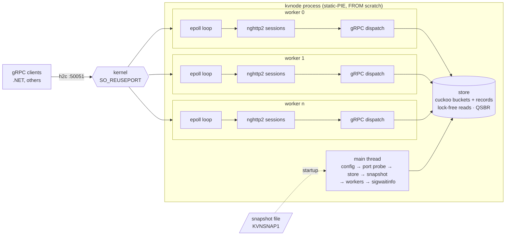

# KvNode architecture

KvNode is a gRPC key-value server written in x86-64 assembly (NASM). It
links two C libraries: glibc and nghttp2 (ADR 0002). This page shows how the
parts fit together. The ADRs record why each choice was made.

## Request path

1. **Accept.** The kernel hashes a new connection to one worker's
   `SO_REUSEPORT` listener. The connection stays on that thread for life,
   so connection state needs no locks.
2. **Read.** The worker's `epoll` loop reads up to 64 KiB and hands it to
   `nghttp2_session_mem_recv2`. nghttp2 parses frames, applies HPACK and
   flow control, enforces stream limits, and invokes callbacks
   (`grpc.asm`).
3. **Route.** Headers decide the route: `:path` picks
   `/kvnode.v1.KvNode/{Get,Put,Delete}` or `/grpc.health.v1.Health/Check`,
   and `:method`, `content-type` and `grpc-encoding` are checked. The body
   is buffered per stream within two budgets: the per-request
   `max_request` and the per-connection `KVNODE_CONN_BUFFER_MB`.
4. **Execute.** At END_STREAM the worker validates the 5-byte gRPC framing,
   decodes the protobuf (zero-copy, `proto.asm`), checks limits and hashes
   the key (SipHash-2-4-128, secret key).
   - Puts, Deletes and health checks execute right there.
   - **GETs are deferred:** their two candidate buckets are prefetched
     immediately, and the stream joins the connection's batch.
   - When nghttp2 has consumed the whole read, `kv_grpc_run_batch` runs two
     passes over the batch: prefetch each candidate record, then look up and
     answer. The cache misses of up to a whole read's GETs thus overlap
     instead of stalling one after another (ADR 0005: +28% at 4 cores and
     +35% at 1 core, paired medians).
   - A GET the peer resets within the same read is freed, not answered.
5. **Respond.** HEADERS, then DATA (the message, via a data provider that
   honors the peer's flow-control window), then trailer HEADERS
   (`grpc-status: 0`). Errors are a single Trailers-Only HEADERS frame.
   All output produced by one input batch is coalesced into one `sendto`.

Allocation on this path goes through the worker's own pool (`pool.asm`).
nghttp2 receives it as its `nghttp2_mem` allocator, and Streams and their
buffers use it too. A session never leaves its worker thread, so the pool
needs no locks. Freed blocks are reused LIFO while still cached.

## Store (ADR 0001, ADR 0003)

- **Table:** 2^k buckets × 64 bytes. Each bucket holds a version word, six
  8-bit tags and six record pointers. It is sized once from
  `KVNODE_CAPACITY` at up to about 83% load and backed by `mmap`
  (`MAP_NORESERVE`, transparent huge pages when available).
- **Lookup:** tag = the top byte of h2; bucket 1 comes from h1; bucket 2 =
  bucket 1 XOR a hash of the tag. By default one SSE2 compare matches the
  tags of both buckets (12 slots); `KVNODE_SCAN=swar` compares one bucket's
  six tags per 64-bit SWAR step instead. The full key is compared exactly
  on a tag hit. At most two cache lines are touched (ADR 0006).
- **Private caches (optional, off by default):** each worker can keep a
  two-level, direct-mapped cache of record pointers
  (`KVNODE_CACHE_L1_BITS`/`L2_BITS`). It is validated against per-key
  invalidation generations that writers bump before retiring a record.
  Measured slower than the CPU's own caches except for tiny hot sets
  (ADR 0006).
- **Insert:** use a free slot in either bucket, or else a bounded BFS (at
  most 256 nodes) finds a displacement path. Moves go backwards, copy first
  and clear second, with bucket versions odd, so a concurrent reader either
  sees the key or retries.
- **Records** are immutable: a 24-byte header, the key padded to 8 bytes,
  then the value. Put allocates and fills the new record outside the writer
  lock and publishes it with one pointer store.
- **Reclamation:** old records go to a limbo list stamped with a global
  epoch. They are freed once every online worker has announced a quiescent
  state since then (QSBR). A worker announces between event batches and is
  offline while it blocks in `epoll_wait`.

## Lifecycle

- **Startup** fails fast, in order: settings (exit 2 on any invalid value),
  port probe (refuses to join another process's `SO_REUSEPORT` group),
  SipHash key from `getrandom`, store, snapshot (exit 1 on any integrity
  error), then every listener bound before any worker starts.
- **Shutdown** begins on SIGTERM/SIGINT (`sigwaitinfo` on the main thread,
  which works as PID 1). Workers close their listeners and send GOAWAY with
  the last processed stream id. In-flight requests complete; health checks
  answer `NOT_SERVING` from then on. Idle connections close with a
  lingering close. Anything still open after `KVNODE_SHUTDOWN_GRACE_SEC` is
  closed. The process exits 0.

## Source map

| Path | Role |
|---|---|
| `server/src/main.asm` | process entry: startup order, signals, shutdown, final stats |
| `server/src/config.asm` | strict environment-variable settings |
| `server/src/worker.asm` | epoll event loop, accept, backpressure, idle timeout, drain, port probe |
| `server/src/grpc.asm` | nghttp2 callbacks, routing, validation, batched GET execution, responses, health service |
| `server/src/pool.asm` | per-worker size-class allocator (nghttp2_mem-compatible) |
| `server/src/proto.asm` | protobuf decode (zero-copy, skips unknown fields) and varint encode |
| `server/src/store.asm` | table lifecycle, Put/Delete, memory accounting, QSBR |
| `server/src/cuckoo.asm` | lock-free lookup (SWAR or SSE2 tag scan), insert with BFS displacement, remove, prefetch stages |
| `server/src/hcache.asm` | optional per-worker private L1/L2 record cache, generation-validated |
| `server/src/siphash.asm`, `util.asm` | SipHash-2-4-128; exact key compare and SWAR tag match |
| `server/src/wlock.asm` | futex writer mutex |
| `server/src/snapshot.asm` | snapshot verification and loading |
| `server/src/log.asm` | one-`write` structured log lines |
| `server/src/abi.asm` | struct layouts exported for the ABI tests |
| `client/dotnet` | .NET client, snapshot writer, tests (Testcontainers) |

## Tests

| Layer | What | Where |
|---|---|---|
| unit (C over assembly) | ABI layouts, the nghttp2 mirror, SipHash vectors, key compare with guard pages, protobuf, store model and torture, snapshot parsing and every rejection reason | `make -C server test` |
| bake-off | cuckoo vs chaining vs trie, every answer verified | `make -C server bench` |
| store levels | lookup variants per memory level (SWAR/SSE2, private caches), every answer verified | `make -C server bench-store` |
| end to end | real server over loopback: protocol and limits, pipelining, cancel, torn-value detection, drain with an in-flight request, idle timeout, snapshot source, startup refusals, h2spec baseline | `make -C server itest` |
| client | 64 SipHash vectors, compaction, byte-exact snapshot vs the server tool, and the real container via Testcontainers | `dotnet test --solution client/dotnet/KvNode.Client.slnx` |

The Docker build runs the unit, bake-off and end-to-end layers. An image
exists only if all of them pass.
