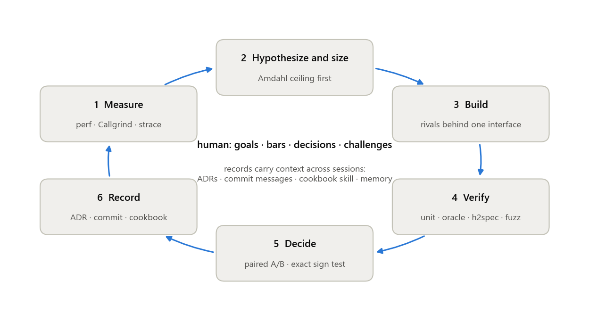
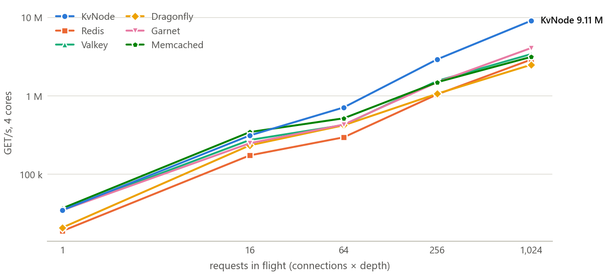
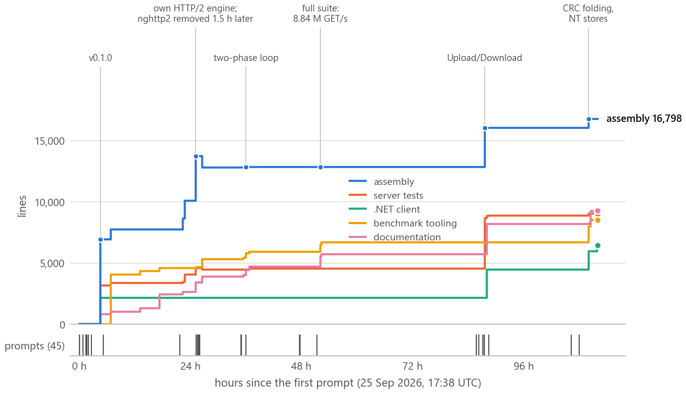

% Measured, Not Argued: An LLM Coding Agent Builds an x86-64 Assembly Key-Value Server That Outperforms Redis on Reads
% A case study of Claude Code (Claude Opus 5.5) reimplementing HTTP/2, HPACK, gRPC, Protocol Buffers and CRC-32C in assembly
% Eli Belash
% KvNode project · Technical report · 1 October 2026

::: abstract
Assembly language is widely regarded as the least productive and least reviewable way to build software, and evaluations of large-language-model (LLM) coding agents have concentrated on high-level languages and short, self-contained tasks. We report a case study at the opposite extreme: a production-shaped network server written in x86-64 assembly by an agentic coding system, Claude Code running Claude Opus 5.5, under the direction of a single developer. Starting from an empty directory on 25 September 2026, the agent produced KvNode, a gRPC key-value server whose 16,798 lines of NASM assemble to 40 KB of machine code. The assembly includes the server's own HTTP/2 engine and HPACK decoder, gRPC and Protocol Buffers codecs with client- and server-streaming calls, a lock-free bucketized cuckoo store with quiescent-state reclamation, and CRC-32C by carry-less multiplication. Around it the agent built a .NET client, a multi-layer test suite, a cross-system benchmark harness and ten architecture decision records. The developer contributed 36 distinct prompts (about 1,150 words) and no code; the agent made 4,453 tool calls across ten sessions and created all 28 commits within five days. Development followed a measured-design loop: every performance hypothesis was profiled, built against rival implementations where the choice was contested, and accepted or rejected by paired, blocked A/B experiments with exact sign tests. The native HTTP/2 engine passes all 146 h2spec conformance cases (the nghttp2 library it replaced passes 138) and doubled per-core throughput. In a 747-run comparison on an Intel i9-13900K, KvNode served 8.84 million GET requests per second on four cores, 2.29–3.68× the throughput of Redis 8.10.2, Valkey 9.1.2, Dragonfly 2.0.0, Garnet 2.1.8 and Memcached 1.6.45 and ahead of each in all ten paired blocks. On one core it reached 1.26× Redis, with a per-request floor equal to a Redis PING. It is behind on write-only workloads (0.87× Redis, 0.60× Garnet) and on 16 KiB values. We describe the practices that made agentic assembly development tractable — differential oracles, conformance suites, fuzzing, mutation-checked regression tests and measurement hygiene on a shared host — the defects they caught, and the threats to validity of a single-developer, single-machine case study.
:::

**Keywords:** LLM coding agents; agentic software engineering; assembly language; key-value stores; HTTP/2; gRPC; performance engineering; benchmarking methodology

# 1 Introduction

In-memory key-value servers are among the most heavily optimized programs in production use. Redis [46] and its fork Valkey [56] execute commands on a single thread and still serve millions of requests per second; Dragonfly [11] and Garnet [34] scale across cores with shared-nothing and epoch-protected designs; Memcached [33] has been tuned for two decades. Beating such systems on throughput per core requires control over cache misses, system calls, allocation and protocol framing at once. The conventional wisdom is that this control is best exercised in C, C++ or Rust: assembly language offers more control still, but at a cost in effort, reviewability and safety that few projects can justify.

LLM coding agents change that cost. Agentic systems now plan, edit, build, test and measure software through tools, over hours or days [1, 24, 57]. Their evaluation, however, has concentrated on high-level languages and on tasks with short horizons: resolving a repository issue [24], improving one function's performance [51] or writing one kernel [43]. Machine learning has produced faster assembly before — AlphaDev discovered sorting routines that were merged into LLVM's C++ standard library [31] — but for small, isolated routines under an automatic objective, not for whole systems.

This paper reports a case study at the other extreme. One developer directed Claude Code [1], running the Claude Opus 5.5 model, to build a gRPC key-value server in x86-64 assembly. Starting from an empty directory on 25 September 2026, the agent produced **KvNode**: 16,798 lines of NASM that assemble to 40 KB of machine code. They include the server's own HTTP/2 engine and HPACK decoder, which replaced the nghttp2 library the server first used, gRPC and Protocol Buffers codecs with client- and server-streaming calls, a lock-free bucketized cuckoo store with quiescent-state-based reclamation, and CRC-32C by carry-less multiplication. Around the server the agent built a .NET client, a multi-layer test suite, a load generator with a statistical harness for comparison against five production systems, and ten architecture decision records (ADRs) [41]. The developer typed 36 distinct prompts, about 1,150 words in total, and no code.

The resulting server is fast. On four cores of an Intel i9-13900K it served 8.84 million GET requests per second: 2.29–3.68× the throughput of Redis 8.10.2, Valkey 9.1.2, Dragonfly 2.0.0, Garnet 2.1.8 and Memcached 1.6.45, and ahead of each in all ten paired blocks of the experiment. On one core it reached 1.26× Redis. Its per-request floor, a gRPC health check carried over HTTP/2, costs as much server CPU as a Redis `PING`. It is also measurably behind on writes and on 16 KiB values; §5.7 reports those results as fully as the favorable ones.

We organize the study around four research questions:

- **RQ1 (Feasibility).** Can an LLM agent build a complete, conformant network server in assembly, including protocol stacks that are normally taken from libraries?
- **RQ2 (Performance).** How does the result compare with state-of-the-art in-memory key-value servers, and where does any advantage come from?
- **RQ3 (Process).** What development process and verification practices made assembly-level agentic development tractable, and what did the human contribute?
- **RQ4 (Limits).** Where did the approach fail, fall short or remain unproven?

Our contributions are:

1. **An artifact and an existence proof.** KvNode is a gRPC key-value server written in x86-64 assembly by an agent. It passes all 146 h2spec HTTP/2 conformance cases and outperforms five production servers on read throughput (§3, §5). The repository contains every benchmark run as raw data (3,481 recorded runs), every script and every decision record.
2. **A measured-design method for agentic systems work.** Every performance hypothesis is profiled, built (against rival implementations where the choice is contested), and accepted or rejected by paired, blocked A/B experiments with exact sign tests (§4.3).
3. **A verification stack for agent-written assembly:** ABI-pinning tests, reference models, differential oracles, conformance suites, independent-stack interoperability, fuzzing and mutation-checked regression tests, together with the defects it caught (§4.4–4.5).
4. **A quantitative account of the human–agent division of labor** over ten sessions, 4,453 tool calls and 28 commits (§4.2, §5.8).
5. **An analysis of limits and threats to validity,** including the conflict of interest inherent in an agent reporting on its own work (§6).

Section 2 reviews background and related work. Section 3 describes KvNode's design, Section 4 the development method and Section 5 the evaluation. Section 6 discusses lessons, limits and threats to validity, and Section 7 outlines future work.

# 2 Background and Related Work

## 2.1 In-memory key-value servers

Redis [46] popularized the in-memory data-structure server. It executes commands on one thread and can offload socket I/O to helper threads; Valkey [56], a Linux Foundation fork of Redis, reworked that I/O threading. Dragonfly [11] partitions the keyspace across threads in a shared-nothing design, in the thread-per-core tradition of Seastar [49], and uses io_uring where available. Garnet [34], from Microsoft Research, is a multi-threaded .NET server built on the Tsavorite store, a descendant of FASTER [6]. Memcached [33] is the long-standing multi-threaded cache.

Research systems have shown how far specialized designs can go. MemC3 [13] introduced optimistic concurrent cuckoo hashing with tag-filtered buckets, libcuckoo [28] extended it with fine-grained locking, MICA [30] co-designed partitioning with the network path, and RAMCloud [42] pursued microsecond latency with kernel bypass. Dataplane operating systems and user-level stacks such as IX [3] and mTCP [23], and RPC systems such as eRPC [25], show that the kernel network path and RPC framing dominate per-request cost at these rates. KvNode deliberately stays within the standard Linux socket API and Docker's default seccomp profile, which blocks io_uring [35]: every gain it reports comes from user-space work per request.

## 2.2 HTTP/2, HPACK and gRPC

gRPC [19] carries each call over an HTTP/2 stream [54]. A call is a HEADERS frame with HPACK-compressed headers [45], DATA frames carrying length-prefixed Protocol Buffers messages [17], and a trailing HEADERS frame with the gRPC status. Production servers delegate this layer to general libraries such as nghttp2 [55], which implement priorities, flow control, a generic header encoder and stream bookkeeping for every kind of HTTP/2 traffic. The layer is also security-critical: the Rapid Reset attack (CVE-2023-44487 [37]) and CONTINUATION floods (CVE-2024-27316 [38]) both exploited stream and header-block handling in widely deployed implementations. h2spec [52] is the de facto conformance suite for HTTP/2 servers.

## 2.3 Low-level building blocks

KvNode's store builds on cuckoo hashing [44] in its bucketized, tag-filtered form [13, 28]. Keys are hashed with SipHash [2], a keyed pseudo-random function that defeats hash-flooding attacks. Lock-free readers use sequence locks [4], whose correctness on x86 rests on its total-store-order memory model [50], and memory that readers may still hold is freed by read-copy-update-style, quiescent-state-based reclamation [21, 32]. The GET path applies group prefetching, which overlaps the cache misses of independent lookups [8, 27]. Checksums use the Castagnoli CRC-32C polynomial [5, 48], computed by folding with carry-less multiplication [18]. Practitioner references on x86 performance [12, 15, 22] seeded the agent's optimization catalog (§4.1).

## 2.4 LLMs for code and for low-level performance

Code-generating language models were first evaluated on function synthesis [7, 29] and later on repository-scale issue resolution, where agent scaffolding with tools for editing, running and testing proved decisive [24, 57]. For performance, LLMs have been trained and prompted to produce performance-improving edits [51], parallel code [39] and GPU kernels [43], and compiler-oriented models reason over intermediate representations and assembly [10]. Search-based systems couple LLMs with evaluators to evolve programs against measurable objectives: FunSearch [47] for mathematical constructions and AlphaEvolve [40] for algorithms and kernels; AlphaDev [31] used reinforcement learning to find faster assembly sorting routines. These works optimize one program component under an automatic evaluator. Our study differs in scope. An agent constructs an entire networked system in assembly — data structures, concurrency, protocol stacks, deployment, tests and benchmarks — and the result is evaluated against production systems rather than against a reference implementation of the same function.

## 2.5 Benchmarking methodology

Fair comparison of servers is notoriously hard. Measurement setups can bias results without any visible error [36], and statistically rigorous evaluation requires repetitions and appropriate tests [16, 26]. Closed-loop load generators hide queueing delay unless latency is measured from intended send times (coordinated omission), which HDR histograms record with bounded error [53]. Workload definitions such as YCSB's scrambled Zipfian distribution [9] make results comparable across systems. KvNode's harness (§5.1) adopts these practices and adds paired, blocked designs suited to a shared, noisy host.

# 3 KvNode: Design of an Assembly gRPC Server

## 3.1 Requirements

The developer's first prompt described the system in a few sentences. It asked for a gRPC service over HTTP/2, written in assembly for a Debian container, storing key-value pairs for any client. Keys would be identified by two 16-byte hashes, with long keys hashed by the client and short ones by the server. SIMD would be used when available, and clients would come in three popular languages, starting with C#. Follow-up prompts added constraints that shaped the design:

- reads and writes must be atomic and concurrency-safe;
- SIMD must not be a requirement;
- the "chance of two hashes colliding is too large" to accept hash-only key identity (ADR 0004);
- every operation must be O(1);
- data may come from clients and from a snapshot file loaded at startup.

Later prompts set performance bars — 2,000,000 GET/s, which the agent read as four cores on the standard workload (ADR 0005), and "exceed performance on 1 core, THIS IS WHY WE ARE ON ASSEMBLY" (commit 9885e64) — and requested streaming transfers of large values (ADR 0010).

Several initial ideas did not survive measurement or analysis, and their revision is part of the method (§4.3). Hash-based key identity was replaced by exact keys, with hashes used only for placement (ADR 0004). Client-side hashing of long keys survived as compaction: a key longer than 64 bytes is sent as 0xFF followed by its SHA-512, and the server never trusts client-supplied hashes. A suggestion that "a linked list to produce a binary tree with assembly tricks" might beat a hash table was tested by a three-way bake-off and disproved (§3.3).

## 3.2 Architecture

Figure 1 shows the process structure. A main thread validates the configuration, probes the listening port, draws a SipHash key from `getrandom`, creates the store, loads the optional snapshot and starts the workers. It then waits for SIGTERM in `sigwaitinfo` and coordinates a graceful drain. Each worker owns a `SO_REUSEPORT` listener, an `epoll` instance, its connections and a lock-free size-class allocator, so a connection never changes threads and its protocol state needs no locks. All workers share one store.

The event loop has two phases (ADR 0009). A worker first reads and processes every connection that `epoll_wait` reported ready, framing all responses into per-connection output buffers; only then does it flush them, back to back. A client thread that owns several connections is therefore woken once per batch rather than once per connection. The loop never spins: four workers holding 1,000 idle HTTP/2 connections used 10 ms of CPU in 10 s, all of it in `epoll_wait`.

## 3.3 The store

The table is an array of 2^k^ buckets of 64 bytes. Each bucket is one cache line holding a version word, six 8-bit tags and six pointers to immutable records. A key's SipHash-2-4-128 digest [2] selects its first bucket and an 8-bit tag; the second bucket is the first XORed with a hash of the tag. A lookup touches at most two buckets. By default one SSE2 comparison matches the tags of both buckets, twelve slots, at once (Listing 1), and any tag hit is confirmed by an exact byte comparison of the key. SSE2 belongs to the x86-64 baseline, so the "no SIMD requirement" rule holds; a SWAR path that compares six tags in one 64-bit operation remains selectable.


Listing: Listing 1. The SSE2 two-bucket tag scan of `kv_cuckoo_get_sse2` in `cuckoo.asm` (excerpt; comments as in the source). Both bucket versions are read before the tags; a set bit in r11d marks a candidate slot in bucket 1 (bits 0–5) or bucket 2 (bits 8–13).
```nasm
    movq    xmm7, rbp
    punpcklqdq xmm7, xmm7               ; tag in all 16 bytes
.retry:
    mov     rax, [r14 + Bucket.ver]
    test    al, 1
    jnz     .busy
    mov     [rsp], rax
    mov     rax, [r15 + Bucket.ver]
    test    al, 1
    jnz     .busy
    mov     [rsp + 8], rax
    movq    xmm0, [r14 + Bucket.tags]   ; loads stay after the version loads (TSO)
    movhps  xmm0, [r15 + Bucket.tags]
    pcmpeqb xmm0, xmm7
    pmovmskb r11d, xmm0
    and     r11d, 0x3F3F                ; bits 0-5: B1 slots, bits 8-13: B2 slots
```

Readers are lock-free and write no shared memory. The bucket's version word acts as a sequence lock [4]: it is odd while a writer moves a key, so a reader that observes an odd or changed version retries. Versions are validated only on a miss, where a key moving between its two buckets could otherwise be overlooked. Writers are serialized by one futex mutex. A Put builds its record outside the lock and publishes it with one pointer store, so a reader sees the old value or the new one, never a mixture. Replaced and deleted records are freed by quiescent-state-based reclamation [21, 32]. Each worker announces a quiescent state between event batches and goes offline around its blocking `epoll_wait`; a record is freed only after every online worker has passed a quiescent state since its retirement. Inserts use a free slot in either bucket or a bounded breadth-first search (at most 256 nodes) for a displacement path, moving keys backwards with bucket versions odd, in the style of MemC3 [13].

The choice of structure was decided by measurement (ADR 0001). The agent built three stores in assembly behind one interface: the production cuckoo table, separate chaining, and a branchless crit-bit trie using `bt`/`sbb` child selection and tagged pointers — the "assembly tricks" of the hypothesis. It measured them with SipHash inside every timed operation, as the server computes it. Table 1 shows the result at 4 million keys. The trie lost by 3.8–5.9× on every operation, with an 18.7× worse 99.9th-percentile latency: branchless descent removes branch mispredictions but not the dependent cache miss at each of its roughly 22 levels. Chaining was competitive only on cache-resident sets.

Table: Table 1. Store bake-off at 4,194,304 keys: one pinned thread, nanoseconds per operation (lower is better), every answer verified. Source: ADR 0001.
| Structure | build | get, dependent | get, independent | miss | update | p99 | p99.9 |
|---|--:|--:|--:|--:|--:|--:|--:|
| Bucketized cuckoo (production) | **180** | **279** | **260** | **166** | **180** | **518** | **714** |
| Separate chaining | 192 | 351 | 350 | 271 | 209 | 807 | 1,897 |
| Branchless crit-bit trie | 849 | 1,060 | 1,064 | 978 | 860 | 1,954 | 13,329 |

The table is sized once from the configured capacity, at most about 83% full, and backed by transparent huge pages. The agent found that, left to the lookups, the first touch of each 2 MiB region mapped the kernel's shared huge zero page and the first insert then split it into 4 KiB pages; the server now writes one byte per region at startup.

## 3.4 A native HTTP/2 engine in assembly

KvNode first used nghttp2 through its sans-I/O API, as ADR 0002 recommended: a production HTTP/2 library seemed safer than putting "the riskiest, most attack-exposed code in the least reviewable language." Profiling overturned that trade-off. At one core, 672 of the 1,427 ns of server time per request were spent inside nghttp2: header and Huffman decoding, its stream hash map, and a full encoder for response headers that never change. Redis spent 720 ns per request in total (ADR 0007). The agent therefore wrote a server-side HTTP/2 engine specialized for what KvNode serves (`h2n.asm`, 3,422 lines) and an HPACK decoder (`hpack.asm`, 1,110 lines). Once the engine was proven, it removed nghttp2 from the server entirely (ADR 0008).

The engine's speed comes from specialization rather than from instruction-level tricks:

- **In-place parsing.** Frames are parsed directly in the worker's 256 KiB read buffer; only a partial frame is carried to the next read. A request body that arrives whole in one DATA frame is dispatched in place.
- **Field meanings instead of string comparisons.** Every HPACK field is classified once (at startup for the static table, on insertion for dynamic entries) into a code for what it means to a gRPC server: the route named by `:path`, the class of `content-type`, `te: trailers`, malformed names. An indexed field then costs one table lookup.
- **A header-block cache.** gRPC clients send byte-identical header blocks for identical calls once their HPACK table is warm. A block equal to the connection's previous one, under the same table generation, replays the recorded effects of its decode. This removed the Huffman decoding of `:path`, which nghttp2-based clients send as a literal on every request, about 23% of the first engine's user time. The HTTP/2 layer fell from about 122 to about 18 ns per request.
- **Precomputed responses.** The first response on a connection inserts `content-type: application/grpc` and `grpc-status: 0` into the client's HPACK table. Every later response's HEADERS block is the two bytes `88 BF`, and its trailers the single byte `BE`. A GET hit is written in one pass: HEADERS, a DATA frame into which the value is copied straight from the store record, and trailers, with no response buffer and no allocation.
- **One-load stream lookups.** Client stream identifiers are odd and increasing, so streams live in an open-addressing map indexed by `(id >> 1) & mask`, where concurrent streams occupy consecutive slots. Deletion shifts entries backwards and has an O(1) fast path.

Specialization did not mean partial conformance. The engine enforces RFC 9113's stream state machine exactly [54]. Two 32-entry rings distinguish streams the server reset, whose late frames must be ignored, from streams that closed normally, whose late frames are errors. It enforces flow control in both directions, CONTINUATION sequencing, PRIORITY validation and every malformed-request rule of the RFC. It defends against rapid reset with a token budget (a burst of 1,000, refilled at 33 per second) and caps header blocks at 64 KiB and 64 CONTINUATION frames. It passes all 146 h2spec 2.6.0 cases with an empty failure baseline; nghttp2 1.70, which no longer tracks closed streams or validates priorities, passes 138 (§5.2).

## 3.5 gRPC, Protocol Buffers and the batched GET pipeline

`grpc.asm` validates and routes requests (method, `:path`, `content-type`, `grpc-encoding`, the 5-byte message prefix) and executes them; `proto.asm` decodes Protocol Buffers without copying and skips unknown fields. Puts, Deletes and health checks [20] execute as soon as their request is complete. GETs are deferred instead: their two candidate buckets are prefetched immediately and the stream joins its connection's batch. When the whole read has been parsed, the batch runs in two passes (ADR 0005). The first pass matches tags in the now-cached buckets and prefetches the first three cache lines of each candidate record; the second looks up and answers each GET. The cache misses of a read's independent GETs thus overlap in the core's line-fill buffers instead of stalling one after another [8, 27]. Because all requests in one read were in flight at once, executing a later Put before an earlier GET's answer remains linearizable; ADR 0005 states the argument and why deferred record pointers stay covered by reclamation. Replies to Puts, Deletes and health checks are built on the stack and framed without allocation.

## 3.6 Streaming transfers and CRC-32C

Two streaming methods move values of up to 64 MiB (configurable to 2 GiB) and byte ranges of them (ADR 0010). An **Upload** is decoded as its DATA frames arrive, by a resumable Protocol Buffers stream decoder whose entire state is 64 bytes per stream. The first message's key and declared size reserve the final record under a per-connection memory budget, and every data piece is copied once, straight from the read buffer into that record, with its CRC-32C computed in the same pass. At the end of the stream the size and checksum are verified and the record is published with one pointer store. A **Download** pins its record, which then stays readable whatever writers do, and generates the response body frame by frame as flow-control windows open. No response buffer exists: a slow reader slows its own call but cannot grow the server.

Listing: Listing 2. Fold constants x^e^ mod P (bit-reflected) computed by the NASM preprocessor at assembly time (`crc32c.asm`, excerpt).
```nasm
%macro FOLD_K 1
  %assign %%r 1
  %rep %1
    %assign %%r ((%%r << 1) & 0xFFFFFFFF) ^ (((%%r >> 31) & 1) * CRC32C_NORMAL)
  %endrep
  %assign %%rr 0
  %assign %%i 0
  %rep 32
    %assign %%rr %%rr | (((%%r >> %%i) & 1) << (31 - %%i))
    %assign %%i %%i + 1
  %endrep
  dq %%rr << 32
%endmacro

fold_k1024: FOLD_K 1087
            FOLD_K 1023
```

The checksum is fused with the copy the bytes need anyway and has four implementations, selected at startup: carry-less folding over eight 128-bit lanes with VPCLMULQDQ and AVX2, the same with PCLMULQDQ [18], the SSE4.2 `crc32` instruction, and slicing-by-8 tables. Fused with a 16 KiB copy in cache they reach about 88, 45, 15 and 3.2 GB/s. NASM's preprocessor computes both the lookup tables and the folding constants at assembly time (Listing 2), so no generated constants are checked in, and two `crc32` instructions finish the folded block instead of a Barrett reduction. Uploads of 64 KiB and more write their records with non-temporal stores, which skip the read-for-ownership of cold destination lines; that copy runs 2.4× faster.

Table 2 summarizes the protocols and formats that KvNode implements in assembly and how each is verified.

Table: Table 2. Protocols and formats implemented in assembly, and their verification.
| Protocol or format | Specification | Implementation | Verification |
|---|---|---|---|
| HTTP/2 framing, stream states, flow control, flood defenses | RFC 9113 [54] | `h2n.asm` (server side, h2c) | h2spec 146/146; fuzzing; grpc-dotnet interoperability |
| HPACK header compression (decoder; precomputed response blocks) | RFC 7541 [45] | `hpack.asm`, generated Huffman automaton | RFC vectors; 30,000 header lists decoded identically to nghttp2 |
| gRPC over HTTP/2: unary, client- and server-streaming calls, Trailers-Only errors | gRPC protocol [19]; health checking [20] | `grpc.asm` | end-to-end suite; 378 .NET tests |
| Protocol Buffers wire format, resumable stream decoder | encoding guide [17] | `proto.asm` | reference model; 200,000 random streams split at random points |
| CRC-32C (Castagnoli) | RFC 3720 [48] | `crc32c.asm`, four paths | every length 0–600 at 16 alignments against a bitwise reference |
| SipHash-2-4-128 | Aumasson and Bernstein [2] | `siphash.asm` | reference vectors in C and .NET |
| HTTP error semantics (405 with `allow`, 415 with `accept`) | RFC 9110 [14] | `grpc.asm` | end-to-end suite; h2spec |
| Snapshot file `KVNSNAP1` | `docs/PROTOCOL.md` | `snapshot.asm` | 15 rejection cases; byte-exact vector shared with the .NET writer |

## 3.7 Footprint

Table 3 lists the modules. The server is 15,086 lines of assembly in 18 source files plus 956 lines of include files; with the two bake-off rivals the repository holds 16,798 lines of NASM. The 17 assembled objects contain 40,131 bytes of machine code and 30 KB of read-only tables, chiefly the HPACK Huffman automaton and the CRC tables. The server links one library, glibc, statically. The static, position-independent executable is about 1.1–1.2 MB, almost all of it glibc, and ships in a `FROM scratch` container image of about 1.6 MB that runs as a non-root user on a read-only file system.

Table: Table 3. KvNode's assembly modules at revision 6871e31: lines of NASM source and bytes of executable code in each assembled object.
| Module | Role | Lines | Code bytes |
|---|---|--:|--:|
| `h2n.asm` | HTTP/2 engine: frames, stream states and map, flow control, precomputed responses, flood defenses | 3,422 | 8,864 |
| `grpc.asm` | validation, routing, batched GETs, health service, Upload and Download | 2,112 | 4,928 |
| `worker.asm` | epoll event loop, accept, back-pressure, idle timeout, drain | 1,500 | 3,408 |
| `store.asm` | table lifecycle, Put and Delete, write-once records, pins, reclamation | 1,466 | 3,406 |
| `hpack.asm` | HPACK decoder: Huffman automaton, dynamic table, field meanings | 1,110 | 3,031 |
| `crc32c.asm` | CRC-32C: folding, SSE4.2 and table paths fused with copies | 1,077 | 5,084 |
| `cuckoo.asm` | lock-free lookup (SSE2 or SWAR), displacement insert, prefetch stages | 917 | 2,305 |
| `proto.asm` | Protocol Buffers decoding, varint encoding, resumable stream decoder | 674 | 1,538 |
| `main.asm` | startup order, signals, shutdown | 594 | 2,728 |
| `config.asm` | strict environment-variable configuration | 504 | 994 |
| `hcache.asm` | optional per-worker record caches (measured, off by default) | 397 | 729 |
| `snapshot.asm` | snapshot verification and loading | 369 | 1,054 |
| `pool.asm` | per-worker size-class allocator | 311 | 542 |
| five small modules | logging, SipHash-2-4-128, key comparison, futex mutex, ABI exports | 633 | 1,520 |
| include files | structure layouts, Huffman table, stream-decoder state | 956 | — |
| **Server total** | | **16,042** | **40,131** |

# 4 Method: How the Agent Worked

## 4.1 Setting

All development ran in Claude Code [1] version 2.1.282 with the Claude Opus 5.5 model (`claude-opus-5-5`) in every session. The host was the developer's Windows 11 workstation, an Intel i9-13900K with 8 hyper-threaded performance cores and 16 efficiency cores (32 logical CPUs). The agent worked through Claude Code's standard tools: a Bash shell, file read, edit, write and search tools, web search for documentation, and a structured question tool for decisions it judged to be the human's. Permission prompts were bypassed, so commands ran without per-command approval and the human reviewed outcomes rather than individual actions. Because the server targets Linux, all assembling, linking and testing happened inside a Docker Desktop (WSL2) development container with NASM 2.16, GCC 14, nghttp2 1.70 (for test clients only, after ADR 0008) and h2spec 2.6.0; `perf` and Valgrind ran in privileged helper containers.

Three kinds of persistent knowledge carried context across sessions and across the ten context compactions that occurred when a session outgrew the model's context window:

- **The repository.** ADRs, a protocol specification, an operations guide, and commit messages unusually rich in evidence (160 KB over 28 commits) that record each change's motivation, measurements and verification.
- **Project memory.** Notes that Claude Code keeps across sessions, in which the agent recorded facts not derivable from the code, such as the host's measurement hazards and their workarounds.
- **A project skill.** `asm-perf-cookbook` (687 lines) catalogs x86-64, assembly and Linux optimization techniques. Each entry carries a status for KvNode (applied with its measured effect, kept within noise, candidate, or rejected with the reason). The skill is explicitly framed as "a lead of ideas, never the limit of what to try."

The work spread over ten sessions, up to four of them active at once. The streaming feature was developed in an isolated git worktree and merged when complete.

## 4.2 Division of labor

Table 4 classifies the human's input. The 45 prompts (36 distinct texts; a prompt was sometimes sent to several parallel sessions) contain no code. They state a vision, impose constraints, set measurable bars, make architectural decisions, ask probing questions and request features, and several corrected the agent's proposals. The agent, in turn, asked the human seven structured questions, typically about trade-offs it judged were not its own to make. One example was whether to run a four-hour benchmark suite while the developer's other workloads were loading the machine; the developer chose to run, and the method was extended to measure and adjust for that load (§4.6).

Table: Table 4. What the human contributed: categories of prompts, with examples quoted from the repository's ADRs and commit messages.
| Category | Example from the repository | What followed |
|---|---|---|
| Constraints | hash-only key identity rejected because "the chance of two hashes colliding is too large" (ADR 0004) | exact keys; SipHash only places keys |
| Hypotheses to test | "a linked list to produce a binary tree with assembly tricks" might beat a hash table (ADR 0001) | three-way bake-off; hypothesis disproved |
| Performance bars | 2,000,000 GET/s at 4 cores (ADR 0005); "exceed performance on 1 core, THIS IS WHY WE ARE ON ASSEMBLY" (commit 9885e64) | batched prefetching; native HTTP/2 engine |
| Decisions | "So we are discarding nghttp fully." (ADR 0008) | nghttp2 removed from the server |
| Probing questions | "store lookup: 93 ns … You are saying we can reduce it to 50ns?" (commit ac100eb); "why are we at all spending time on wakeup?" (commit a0264f7) | quiet-host decomposition (43.5 ns alone); wakeup analysis |
| Corrections | "Fix: why do we need a lock, we can just atomically increment." (commit 29ab560) | lock-free revision design, verified by a concurrent checker |
| Features | client and server streaming with dedicated byte-streaming APIs, tested against network interruptions (ADR 0010) | Upload and Download with fault-injection tests |

The agent's side, in numbers:

- 4,453 tool calls: Bash 2,120, Edit 1,502, Read 378, Write 331, Grep 64, web search and fetch 19, structured questions 7 and 32 others;
- 513 of those calls edited or wrote assembly sources;
- 2,948 model responses producing 6.7 million output tokens;
- all 28 commits, created by the agent's own git commands;
- about 27 hours of wall-clock time with at least one session active, between the first prompt and the last commit 4.7 days later.

That is roughly 124 tool calls per distinct human prompt.

## 4.3 The measured-design loop

Every non-trivial change followed the loop in Figure 2.

{width=5.6}

1. **Measure where the time goes.** The agent profiled with `perf` (CPU-clock sampling, since WSL2 exposes no hardware counters), including kernel symbols through a privileged helper container. It split user from kernel time with `/proc` and counted system calls with `strace`. When the host was too loaded for timing, it counted exact instructions per request with Callgrind, mapping NASM addresses to symbols itself because NASM's debug information names no functions.
2. **Hypothesize and size the opportunity.** The profile in §3.4, for example, bounded what any HTTP/2 rewrite could gain (the 672 ns inside nghttp2) before a line of the engine was written.
3. **Build, rivals included.** Where a choice was contested, the agent implemented the alternatives behind one interface: three store structures (Table 1), SWAR against SSE2 tag scans, private per-worker record caches against none, four CRC-32C paths, and both HTTP/2 engines side by side for a day before nghttp2 was removed.
4. **Verify** with the gates of §4.4.
5. **Decide by paired measurement.** Variants ran interleaved within blocks in rotated order, or concurrently on pinned CPUs with their slots swapped every block. They were compared by per-block ratios and exact sign tests; six blocks that all agree give p = 2 × 2^−6^ ≈ 0.031.
6. **Record.** Each decision became an ADR or an amendment, with its numbers, rejected alternatives and consequences. The commit message carried the evidence, and the cookbook entry's status was updated.

Figure 3 shows the measured effect of every design decision for which the repository records a paired comparison. The loop rejected as often as it accepted. A stream-lookup cache was neutral. Per-worker software record caches, built with a correctness argument under x86-TSO, were 7–46% slower than relying on the CPU's own caches beyond L1-sized working sets, and remain off by default. An extra record-line prefetch measured within noise and was kept only for the stall it removes. Inlining a 184-byte zeroing loop saved nothing over glibc's AVX2 `memset` and was reverted. Measurements also overruled the agent itself. It predicted that a larger benchmark client would raise eight-core throughput; a paired test found the client 12% slower (0.877×, 6/6 blocks), because the host had no physical cores left (§5.7). In the design of lock-free revisions for a proposed Watch API, a per-writer announcement scheme that looked safe was caught by a concurrent verifier moving its watermark backwards 312–3,070 times per run, and was replaced.


## 4.4 Verification for assembly

Assembly offers no type system, no bounds checks and no sanitizer-friendly abstractions, so verification had to come from outside the code (Table 5). Every layer except the .NET suite runs inside the Docker build, and an image exists only if all of them pass. ADR 0008 states the principle behind the independent layers: "A server checked only by its own code verifies only its own understanding of the protocol." After nghttp2 left the server, it was kept as the end-to-end test client, the HPACK oracle and the benchmark client.

Table: Table 5. Verification layers for the assembly server.
| Layer | What it checks | Scale |
|---|---|---|
| ABI pinning | structure layouts and constants shared by assembly and the C tests, exported from assembly and compared in C | every structure that crosses the boundary |
| Unit tests (C over assembly) | SipHash vectors; key comparison with guard pages; Protocol Buffers and the stream decoder against a reference model; CRC paths against a bitwise reference; the allocator against a reference allocator; the store model; every snapshot rejection | 12 test programs; 200,000 random streams; a 60,000-step allocator model |
| Concurrency torture | 8 readers and 4 writers with relocations and reclamation; pinned readers across quiescent states; freshness after completed writes | no torn or stale read; ~360,000 pins held |
| Differential oracle | the HPACK decoder against nghttp2's encoder and decoder | 30,000 random header lists (194,660 fields) decoded identically |
| Self-checking generators | the Huffman automaton is rebuilt from RFC 7541's code lengths and verified (round trips, RFC strings, padding rules) before it is emitted | all 257 symbols |
| Conformance | h2spec 2.6.0 | 146/146, empty failure baseline |
| End to end | the real server over loopback through an independent HTTP/2 client: every status and limit, pipelining, cancellation, drain, idle timeouts, a 469-transfer streaming matrix, requests split at every byte, 1-byte windows, torn-value detection | 9 phases per build |
| Fuzzing | garbage, mutated requests, frame soups, HPACK soups, truncation, random write splits; liveness and memory bounds; then the full suite on the same server | 3,000 connections per build; soaks of 20,000 and 3 × 20,000 |
| Independent interoperability | the .NET client on grpc-dotnet's HTTP/2 stack, which shares no code with nghttp2 or KvNode, against the real container, including a fault-injecting TCP proxy | 378 tests on .NET 8 and .NET 10 |
| Mutation checks | each new regression test run against a deliberately broken build to prove it fails | e.g. reclamation ignoring pins; budgets never returned; flush budget removed |

## 4.5 Defects caught

The agent's code was not correct the first time; the verification layers caught its defects before release. Table 6 lists the defects recorded in the commit history.

Table: Table 6. Defects in agent-written code caught before release, as recorded in commit messages.
| Defect | Component | Caught by |
|---|---|---|
| Use-after-free: a literal with incremental indexing could evict the dynamic entry it names while being inserted | `hpack.asm` | review and a regression test before first use (ec83e0e) |
| Out-of-bounds read: an oversize Huffman string was still classified, reading past the scratch buffer | `hpack.asm` | review and tests (ec83e0e) |
| A forced reclamation took a rate-limited shortcut and could leave retired records in limbo | `store.asm` | multi-threaded store test under new timing (dd28221) |
| Validation hole: two keys sharing one hash could validate against different slots and reach a freed record | `hcache.asm`, first draft | the correctness argument written in the file header (dd28221) |
| Latent use-after-free: a drain started mid-batch could destroy a connection whose event was still pending | `worker.asm` | analysis while restructuring the event loop (c3dec96) |
| A peer that stopped reading at the TCP level was never disconnected and held pinned records indefinitely | `worker.asm` | stall test with a WAN-sized TCP segment (1372f7d) |
| A varint truncated at a message's last byte was diagnosed only at the end of the stream | `proto.asm` | reference-model tests (1372f7d) |
| `found ? memory : null` assigned to a nullable `ReadOnlyMemory<byte>` yields empty memory, not null | .NET client | container integration tests (d95793d) |
| A refused upload could wait forever for flow-control credit the server never grants | .NET client | a test-class ordering; diagnosed with an async heap dump (bb42b44) |
| A drain test slept instead of synchronizing and failed under heavy host load | integration tests | a flaky failure; fixed with a PING handshake (a0264f7) |

Two lessons recur. First, loopback hides network behavior: the kernel sizes a loopback socket's buffers from its 64 KiB maximum segment size, so the stuck-peer defect appeared only when a test advertised a 1,200-byte segment, as real networks do. Second, a regression test proves nothing until it fails against the defect. Two plausible tests for the .NET hang passed against the pre-fix code, and only the class-level sequence reproduced it. Mutation checks therefore became standard practice.

## 4.6 Measurement integrity on a shared, noisy host

The benchmarks ran on the developer's working machine, alongside their other workloads, and the agent discovered this the hard way. In the first full benchmark session, identical runs differed by up to 3×, and throughput changed within single runs. Sampling the Windows host, the agent found other programs using 14–23 of the 32 logical CPUs outside the container VM, invisible to any container cgroup. Rather than stop the developer's work, it extended the harness (METHODOLOGY.md):

- an outside-load sampler records each run's host load;
- a blocked, randomized design with paired within-block ratios cancels slow drift;
- the analysis reports the correlation between outside load and throughput and adjusts every comparison to equal load by analysis of covariance;
- a ten-run stability experiment repeats the headline cell at the end of each session.

The agent itself was a second source of interference. Several sessions shared the Docker VM, and one session's build or benchmark inside the VM was invisible to the outside-load monitor. The agent added an in-VM watcher, pinned to an unused vCPU, that logged per-vCPU and per-container CPU every five seconds. It certified 745 of the 747 runs of the final session as clean; the other two each showed a single isolated five-second blip. For short experiments, Docker's event log served as a zero-overhead certificate that no other container or command ran in the window. Contaminated runs were discarded and repeated. Mistakes in the record were corrected forward, never rewritten. Commit 171ae57 carries an erratum for a timing claim in an earlier commit message, and ADR 0006 carries a correction of its absolute lookup cost: 89 ns, inflated by benchmark bookkeeping, against 43.5 ns measured cleanly.

# 5 Evaluation

## 5.1 Setup

Table 7 lists the compared systems: the latest stable release of each on the test date, pinned by image digest. All servers ran without persistence, TLS or authentication, and with eviction impossible, on `--cpuset-cpus 0..N-1`. Redis and Valkey used I/O threads and Dragonfly io_uring (the host's Docker daemon allowed it). Each system's thread count was tuned per core budget in a separate experiment (E0).

The load generator, kvbench, is one C program that drives every protocol — RESP2, the memcached meta protocol, and gRPC over HTTP/2 through nghttp2's client — with the same threads, connections, request depth, workload generator, timing and histograms. It validates every response byte by byte; any error, miss or wrong value invalidates the run. It ran on vCPUs 16–31, joined the server's network namespace and connected over loopback. In a client-validation experiment (E8), kvbench matched or beat redis-benchmark and memtier_benchmark against Redis (1.03–1.06×) and drove KvNode 1.58× faster than h2load, so the comparison handicaps no system.

Table: Table 7. Systems compared (session of 27 September 2026, KvNode revision a0264f7).
| System | Version | Architecture | Protocol |
|---|---|---|---|
| KvNode | 0.1.0 (a0264f7) | x86-64 assembly; thread-per-core workers over one shared store with lock-free reads | gRPC over HTTP/2 (h2c) |
| Redis | 8.10.2 | single-threaded command execution, I/O threads | RESP2 |
| Valkey | 9.1.2 | Redis fork with reworked I/O threading | RESP2 |
| Dragonfly | 2.0.0 | shared-nothing, multi-threaded, io_uring | RESP2 |
| Garnet | 2.1.8 | multi-threaded .NET server, Tsavorite store | RESP2 |
| Memcached | 1.6.45 | multi-threaded cache | meta protocol |

The standard workload is 100% GET over 1,000,000 preloaded 16-byte keys with 100-byte values, chosen uniformly, with 64 connections × 16 requests in flight. Each run starts a fresh server, preloads every key, warms up for 5 s and measures for 10 s. Repetitions form blocks: within a block every system runs once, in seeded random order, so slow drift affects all systems of a block alike. KvNode is compared with each system by the ratio of medians, the range of within-block ratios and an exact two-sided sign test; with six blocks, p < 0.05 requires all six to agree. The session analyzed here comprised 747 runs, all valid. Its stability experiment (S1) repeated the four-core cell ten times per system on a quiet host. The testbed was an Intel i9-13900K under Docker Desktop 27.3.1 on WSL2 (Linux 5.15).

## 5.2 RQ1: Conformance and robustness

The native HTTP/2 engine passes all 146 h2spec 2.6.0 cases. nghttp2 1.70 linked into the same server passed 138: seven of its failures follow from upstream's removal of closed-stream tracking and priority validation in version 1.65, and one is shared by every nghttp2 release (ADR 0002). The HPACK decoder decodes 30,000 random header lists from nghttp2's encoder, 194,660 fields, identically to nghttp2. Every build fuzzes the HTTP/2 input path over 3,000 connections and then runs the full suite on the fuzzed server. A 20,000-connection soak left the server alive with resident memory growing from 988 to 1,080 KiB, and three further 20,000-connection soaks that included Upload and Download soups grew it by about 1 MB and left no record pinned. The .NET client, whose HTTP/2 stack (grpc-dotnet) shares no code with KvNode or nghttp2, passes 378 tests on two target frameworks against the real container, including transfers through a proxy that resets, hangs and throttles connections.

RQ1 is answered affirmatively: the agent built a conformant, hardened protocol stack in assembly, and it is the server's only HTTP/2 implementation.

## 5.3 RQ2: Throughput against the state of the art

Figure 4 and Table 8 summarize the headline results.


Table: Table 8. Headline results: medians, then KvNode ÷ system paired by block (S1: 10 blocks; N1: 6 blocks) with the range of within-block ratios.
| Experiment | KvNode | Redis | Valkey | Dragonfly | Garnet | Memcached |
|---|--:|--:|--:|--:|--:|--:|
| S1: GET/s, 4 cores | **8.84 M** | 2.88 M | 3.20 M | 2.40 M | 3.86 M | 3.01 M |
| KvNode ÷ system | — | 3.07× | 2.76× | 3.68× | 2.29× | 2.94× |
| range over blocks | | 2.76–3.84 | 2.52–2.97 | 3.40–4.25 | 2.09–2.47 | 2.73–3.21 |
| N1: GET/s, 1 core | **1.76 M** | 1.40 M | 1.42 M | — | — | — |
| KvNode ÷ system | — | 1.26× | 1.24× | — | — | — |
| range over blocks | | 1.22–1.38 | 1.20–1.28 | | | |
| N1: server CPU per GET | **576 ns** | 722 ns | 710 ns | — | — | — |
| E5: CPU per no-op, 1 core | **472 ns** | 479 ns | 525 ns | 541 ns | 774 ns | 1,837 ns |

On four cores (S1) KvNode served 8.84 M GET/s. It was ahead of every system in all ten blocks (sign test p = 0.002 for each comparison): by 2.29× over the strongest competitor, Garnet, and by 3.07× over Redis. Its between-run coefficient of variation was 4.2%. On one core (N1), against the two servers whose command execution is single-threaded, KvNode reached 1.26× Redis and 1.24× Valkey in all six blocks (p = 0.031), using 576 ns of server CPU per GET against 722 and 710 ns. The per-request floor (E5), a no-op round trip, was 472 ns of server CPU for KvNode's gRPC health check and 479 ns for a Redis `PING`. Carrying a request over HTTP/2 and gRPC now costs KvNode no more server CPU than the far simpler RESP costs Redis. With nghttp2, the same floor had been 1,086 ns.

Four-core throughput is a lower bound for KvNode. kvbench's gRPC client tops out near 9.3 million requests per second on its 16 vCPUs; in S1 the client was 80% busy while KvNode's cores were 96% busy, and at eight cores KvNode's cells are client-bound (§5.7). In a scaling experiment from one to eight cores, run mostly while outside load kept 11–18 logical CPUs busy, KvNode led every system at every core budget in every block, with one exception: Garnet at eight cores (1.21×, 5 of 6 blocks).

## 5.4 RQ2: Breadth — mixes, latency, concurrency and value size

Table 9 extends the comparison to read/write mixes, unpipelined requests and larger values. KvNode leads every read-heavy workload, including the skewed one (Zipf 0.99). It ties Garnet at 50% writes and is behind Garnet, Redis and Dragonfly on pure writes (§5.7). Without pipelining (256 connections with one request each) it serves 815 k requests/s, 1.34× the next system, with the lowest median latency (274 µs). With 1 KiB values it leads by 1.77–3.66×. With 16 KiB values it is behind Garnet and Memcached by half.

Table: Table 9. Further workloads on four cores (medians of 6 blocks, or 3 for the value sizes; the best result in each row is in bold).
| Workload | KvNode | Redis | Valkey | Dragonfly | Garnet | Memcached |
|---|--:|--:|--:|--:|--:|--:|
| 90% GET | **7.66 M** | 2.88 M | 3.01 M | 2.43 M | 3.96 M | 2.95 M |
| 90% GET, Zipf 0.99 | **7.87 M** | 2.98 M | 3.09 M | 2.57 M | 4.19 M | 4.13 M |
| 50% GET | 3.79 M | 2.65 M | 2.24 M | 2.33 M | **3.84 M** | 2.36 M |
| 100% SET | 2.23 M | 2.58 M | 1.78 M | 2.48 M | **3.75 M** | 1.54 M |
| No pipelining, 256 × 1 | **815 k** | 393 k | 588 k | 440 k | 420 k | 609 k |
| 1 KiB values | **5.59 M** | 1.91 M | 1.85 M | 1.53 M | 3.16 M | 2.47 M |
| 16 KiB values | 481 k | 461 k | 273 k | 444 k | 972 k | **995 k** |

Figure 5 sweeps concurrency. With one request in flight, throughput is one over the round-trip time: KvNode's 24.7 µs round trip is level with Valkey, Garnet and Memcached and about half of Redis's and Dragonfly's 48 µs. At 16 in flight Memcached is ahead (0.90×). From 64 in flight upward KvNode leads every system, reaching 9.11 M GET/s at 1,024 in flight, 2.23× Garnet.

Under open-loop load at identical offered rates (Table 10), with latency measured from intended send times, KvNode's 99th percentile stays at or below 0.44 ms up to 1.25 M requests/s. Only Valkey's is lower; Garnet's tail grows to 93 ms at the highest rate. At the lowest rate KvNode's median (101 µs) is slightly above Valkey's (93 µs) and Memcached's (97 µs). Every system kept up with every offered load. With three runs per cell, these figures are estimates.

Table: Table 10. Open-loop latency on four cores at identical offered loads (µs; Poisson arrivals; no coordinated omission; medians of 3 runs).
| System | p50, 418 k/s | p99, 418 k/s | p50, 836 k/s | p99, 836 k/s | p50, 1.25 M/s | p99, 1.25 M/s |
|---|--:|--:|--:|--:|--:|--:|
| KvNode | 101 | 375 | 117 | 444 | 111 | 428 |
| Redis | 222 | 651 | 317 | 889 | 379 | 913 |
| Valkey | **93** | **253** | 142 | **358** | 173 | **395** |
| Dragonfly | 171 | 848 | 387 | 1,516 | 553 | 2,343 |
| Garnet | 107 | 1,270 | 134 | 8,978 | 134 | 92,799 |
| Memcached | 97 | 428 | **107** | 635 | 134 | 1,090 |



KvNode's memory use is ordinary: about 180 bytes per key for 16-byte keys and 100-byte values including its table (Redis 174, Valkey 173, Dragonfly 157, Memcached 196, Garnet 285), the least of all six systems at 16 KiB values, and about 9 KiB per idle connection.

## 5.5 RQ2: Where the advantage comes from

Figure 6 locates the gain. With nghttp2, a request cost 1,427 ns of server time on one core: about 485 ns in the kernel, 672 ns in nghttp2, 222 ns in KvNode's own assembly and 47 ns in libc. After the native engine, a request cost about 620–650 ns, of which 75–79% was the kernel. The kernel's time barely moved; user space fell from about 940 ns to about 140 ns. `strace` shows the minimum possible system-call pattern for this workload: one `read` and one `sendto` per 16 requests, the same pattern Redis has. Of the remaining user-space instructions (1,425 per GET, counted exactly), HTTP/2 frame parsing (20%) and SipHash (18%) are the largest items, and parsing, response framing and stream bookkeeping together take half. The store lookup is 11% of the instructions but most of the remaining user time, as memory stalls that the batched prefetching already overlaps. Alone, a batched lookup costs 43.5 ns at 1 M keys: about 12 ns of SipHash, 9 ns of computation and 23 ns of memory.

Three measured decisions account for most of KvNode's lead (Figure 3). The native HTTP/2 engine doubled throughput per core (2.03× at one core, 1.96–2.07× at two and four). Batched GETs with two-stage prefetching added 28% at four cores and 35% at one. The two-phase event loop added 12% with the harness's four connections per client thread, and 26% with eight. Table 11 shows the combined effect between two full benchmark sessions one day apart. KvNode's own throughput rose up to 3.3× while the other systems moved by about ±10%. The exception, 16 KiB values, is a regression (§5.7).

Table: Table 11. KvNode's change between two full sessions: the nghttp2 build (26 September, 8cb0fef) and the final server (27 September, a0264f7). The last column bounds the other five systems' change between the same sessions, i.e. the host's drift.
| Cell | nghttp2 build | final build | KvNode change | Other systems' change |
|---|--:|--:|--:|--:|
| 4 cores, 100% GET (S1) | 2.93 M | 8.84 M | **3.02×** | −6% to 0% |
| 90% GET | 2.75 M | 7.66 M | 2.79× | 0% to +10% |
| 50% GET | 2.30 M | 3.79 M | 1.65× | −1% to +8% |
| 100% SET | 1.72 M | 2.23 M | 1.30× | 0% to +8% |
| No pipelining | 618 k | 815 k | 1.32× | −15% to −6% |
| No-op round trip, 1 core | 923 k | 2.13 M | 2.31× | −12% to −5% |
| 1 KiB values | 2.63 M | 5.59 M | 2.13× | −10% to −5% |
| 16 KiB values | 691 k | 481 k | **0.70×** | −8% to −5% |
| 1,024 in flight | 2.77 M | 9.11 M | 3.29× | +3% to +8% |

![Figure 6. Where a GET's server cost goes on one core. (a) Server time per request before and after the native HTTP/2 engine (perf CPU-clock profiles under the standard load). Before: kernel 485, nghttp2 672, KvNode 222 and libc 47 ns. After: about 620–650 ns, of which the kernel is 75–79%; the blue segment is then all user space, KvNode and libc together, and the split is approximate. (b) User-space instructions per GET in the final server, counted exactly with Callgrind; every attribution except SipHash's is approximate.](figures/fig6_breakdown.png)

## 5.6 Streaming transfers

Upload and Download were measured with paired, concurrent A/B runs on pinned cores (ADR 0010). One server core accepts about 11 GB/s of 1 MiB uploads and serves about 6 GB/s of 1 MiB downloads over loopback. Upload moves bytes 2–3× faster than a unary Put of the same value, because it copies once instead of buffering and then copying. A performance pass driven by profiles found that one `crc32` dependency chain was 49% of an upload worker's CPU. Folding CRC, non-temporal record stores and 256 KiB reads then raised uploads by 2.30×, 1.70× and 1.56× (64 KiB, 1 MiB and 16 MiB values) and downloads by 1.22–1.28×, with GET throughput unchanged (1.000×). The .NET client, which had become the bottleneck, received the same folding CRC, an allocation-free codec, a 16 MiB HTTP/2 receive window and four connections per client. One client then moved 3.89× more upload bandwidth (1.83 → 7.23 GB/s) and 2.47× more download bandwidth, with 98% less allocation per download.

## 5.7 RQ4: Where KvNode falls short

- **Writes.** Pure SET throughput on four cores is 2.23 M/s: 0.87× Redis (five of six blocks; clear after adjustment for outside load), 0.90× Dragonfly and 0.60× Garnet, though ahead of Valkey (1.26×) and Memcached (1.45×). Every write passes one futex mutex (ADR 0003) and executes at dispatch, outside the GET prefetch pipeline. A SET costs 1.26× a GET's instructions but about 4× its time, because its cache misses are not overlapped. A store-level prototype of write batching cut a replace from 433 to 126 ns, but it is not implemented.
- **Large values.** At 16 KiB, KvNode serves 481 k GET/s, half of Garnet's and Memcached's and 30% below its own nghttp2 build. This regression was caught by the benchmark suite, not by any test, because no performance gate exists. It has not been bisected; the recorded hypotheses are a second DATA frame for messages just over the 16,384-byte default frame size, flow-control windows, and the two-phase loop's buffering.
- **Scale beyond four cores.** It cannot be measured on this host. The gRPC client needs about 2.8× the server's CPU per request and saturates near 9.3 M requests/s. With eight server vCPUs KvNode reached 9.72 M GET/s while its cores were only 69% busy and the client 97% busy. Giving the client 24 vCPUs instead of 16 made the run 12% slower, because the CPU's 24 physical cores were already occupied. Eight-core figures are floors; a second machine is required.
- **Scope.** KvNode offers exact-key Get, Put and Delete, streaming transfers and a health service. It has no persistence, TLS, authentication, replication, expiry, IPv6 listener or rich data types. Redis-compatible servers do much more, and their richer protocols cost them per request. Persistence, Export/Watch streams and key indexes exist only as proposals backed by prototype measurements.
- **Testbed.** One virtualized machine over loopback. There is no NIC, so per-request protocol overhead weighs more than it would across a network, which penalizes gRPC most. Waking co-located clients cost up to 48% of a server core under WSL2's virtualization before the two-phase loop reduced it.

## 5.8 RQ3: Development effort

Table 12 and Figure 7 quantify the effort. The first working server, with its store, nghttp2-based gRPC, tests, .NET client and the first four ADRs, was committed 4.6 hours after the first prompt. The native HPACK decoder, the native HTTP/2 engine and the removal of nghttp2 landed within four hours of one another, between 23 and 27 hours in. The full benchmark session behind Table 8 completed 52 hours in, and the streaming feature and its performance pass by 112 hours. Human prompts arrived in short bursts: long stretches of agent work followed each one, interrupted only when the agent asked a question.



Table: Table 12. Development effort, from the repository and the Claude Code session transcripts (the session that drafted this paper is excluded).
| Measure | Value |
|---|---|
| First prompt to last commit | 4.7 days (25 Sep, 17:38 UTC, to 30 Sep, 09:34 UTC) |
| First prompt to v0.1.0 (working server, tests, .NET client, ADRs 0001–0004) | 4.6 hours |
| Wall-clock time with at least one session active (records at most 15 min apart) | 27.2 hours (37.2 session-hours) |
| Sessions; peak concurrency; context compactions | 10; 4; 10 |
| Human prompts (distinct texts); words in the distinct texts | 45 (36); 1,151 |
| Structured questions the agent asked the human | 7 |
| Tool calls: Bash / Edit / Read / Write / other | 4,453: 2,120 / 1,502 / 378 / 331 / 122 |
| Edits and writes to assembly files | 513 |
| Model responses; output tokens | 2,948; 6.7 million |
| Commits, all created by the agent | 28 |
| Lines at the last commit: assembly / server tests / .NET / benchmark tooling / documentation | 16,798 / 9,044 / 6,449 / 8,504 / 9,293 |
| Decision records; proposals | 10; 4 |
| Benchmark runs committed as raw data | 3,481 |

# 6 Discussion

## 6.1 What made assembly tractable for an agent

Writing instructions was not the hard part. The defects recorded in the history (Table 6) are lifetime, bounds and protocol-logic errors, the same classes that afflict C, rather than instruction-level slips; the build and unit tests catch the latter within minutes, and the history does not record them. The hard parts were those of any systems project: concurrency protocols, protocol state machines, resource lifetimes and performance. The agent met them with practices that compensate for assembly's opacity.

- **Contracts in comments.** Routines carry headers stating their parameters, return values, scratch registers and concurrency obligations; the sources hold 187 `@returns` annotations for 108 exported symbols and many internal routines. They contain 3,552 comment-only lines, and 1,499 of their 11,932 code lines carry an inline comment. This made the code reviewable for the human and for later sessions of the agent.
- **Tests as the type system.** Structure layouts are exported from assembly and compared in C, so a layout change that would corrupt memory fails the build instead.
- **Generated, self-checking constants.** CRC tables and fold constants are computed by NASM's preprocessor, and the Huffman automaton by a generator that verifies itself, so no error-prone constant is typed by hand.
- **Independent oracles.** nghttp2, h2spec, grpc-dotnet and bitwise reference implementations judge the assembly from outside.

## 6.2 Why the result is fast, and whether assembly was necessary

The evidence attributes KvNode's lead mainly to three design decisions: specializing the HTTP/2 layer (2.03× per core over the same server with nghttp2), overlapping memory latency across a batch of GETs (1.28–1.35×) and flushing once per event batch (1.12–1.26×). None of them requires assembly. All of them require owning the whole request path and being willing to replace a general-purpose library with a specialized one. Assembly made some things easier: there is no runtime, and memory layout, cache-line placement, register use in hot loops and assembly-time constant generation are under exact control. It made nothing measurably harder for the agent. The study cannot, however, separate the contribution of the language from that of specialization; a C or Rust implementation of the same design might perform similarly. What it does show is that, for an agent, writing in assembly no longer carries the productivity and verification penalty that has kept it out of whole-system work.

## 6.3 The human's role

The human set direction with few words, and the agent supplied options, evidence and implementation. The most consequential human inputs were bars and challenges that turned profile observations into projects: exceed Redis on one core; "can we change that?" about the 48% of a core spent waking clients; "why do we need a lock?" about a revision counter. Several decisions were explicitly the human's: dropping nghttp2, benchmarking under load, choosing features. The agent made many technical decisions autonomously but recorded each with its evidence, so the human could audit after the fact instead of approving each step in advance. We regard this pattern — decide by evidence, record everything — as essential when an agent works on consequential code without per-action approval.

## 6.4 Failure modes and risks

- **Defects.** The agent introduced the defects of Table 6; verification caught them but did not prevent them. KvNode has had no external security review, and its memory safety rests on tests and fuzzing rather than on a type system or a formal proof.
- **Overconfident claims.** The record contains an incorrect timing statement in a commit message (corrected by erratum), an inflated absolute lookup cost in an ADR (corrected) and a wrong prediction about the benchmark client (disproved by measurement).
- **Undetected regressions.** The 16 KiB regression passed every functional test.
- **Environment.** Build processes stuck in uninterruptible sleep in the Docker VM, a transient compiler crash and parallel sessions contaminating each other's measurements were all detected and handled, at a cost in time.
- **Maintainability.** 16,798 lines of assembly are a liability for human maintainers. Documentation density and the ADRs mitigate this, but a long-term maintenance study is beyond this paper.

## 6.5 Threats to validity

**Internal validity.** The host was shared, virtualized and hybrid (performance and efficiency cores). We mitigated this with outside-load measurement and adjustment, blocked and paired designs, an in-VM watcher and concurrent A/B runs. Absolute numbers across sessions are unreliable, because the hypervisor places vCPUs on different core types from session to session, so we quote within-session paired ratios.

**Construct validity.** GET throughput with 100-byte values is KvNode's best case. We therefore also report mixes, writes, value sizes, open-loop latency and the no-op floor. The protocols differ, and gRPC costs more bytes and client CPU per request than RESP; that cost is real for users and is not factored out.

**External validity.** One developer, one project, one model version, one machine and one workload class (small-object, exact-key access). The results may not transfer to other domains, to other agents or to developers with less systems experience to steer them.

**Conclusion validity.** Comparisons rest on 6–10 blocks with exact sign tests; cells with three repetitions are descriptive only.

**Conflict of interest.** The same agent designed the benchmark, built the system and drafted this report. Several mitigations apply. The published session and the analysis rules were fixed before comparisons were examined, and the commits record when. All raw data and scripts are committed, rival versions are pinned by digest, and kvbench was validated against each ecosystem's standard tools. Independent replication on other hardware, ideally with clients on a separate machine, is the most important next step.

# 7 Future Work

The measured leads are recorded in the repository with their evidence:

- close the write gap with batched writes (a store-level prototype is 3.4× faster per replace) and a huge-page record slab (+6% GET throughput measured with allocator tunables);
- serve whole-value downloads zero-copy from pinned records with stored checksums (up to about 1.5× per worker, estimated from profiles);
- bisect the 16 KiB regression and add performance-regression gates to the build;
- add persistence through a hybrid-log write-ahead store that keeps O(1) operations, and Export/Watch streams with lock-free revisions and glob/regex filters compiled to DFAs (both exist as proposals with prototype measurements);
- replicate the benchmarks on bare metal with clients on a separate machine, and model-check the seqlock, reclamation and pinning protocols;
- implement clients in two more languages against the published protocol and conformance vectors.

# 8 Conclusion

We asked whether an LLM coding agent can build, in assembly, a networked system that holds its own against the state of the art. In this case study it did. In under five days, directed by about 1,150 words of human input, Claude Code with Claude Opus 5.5 produced a gRPC key-value server whose own HTTP/2 engine passes every h2spec case. On four cores it serves 2.3–3.7× the read throughput of Redis, Valkey, Dragonfly, Garnet and Memcached. The result came not from writing assembly as such but from a loop the agent kept throughout: measure, build rivals, verify against independent oracles, decide by paired statistics and record the evidence. The same loop exposed where KvNode is behind — writes, large values, unmeasured scale — and those results are part of the contribution. For this agent, assembly was no barrier; measurement was the method.

# Acknowledgments and AI-use statement

KvNode's code, tests, benchmarks and documentation were written by Claude Code (Claude Opus 5.5, Anthropic) under the direction of the author, who set the requirements, performance bars and decisions. This report was drafted by the same agent from the repository's records at the author's request. Every quantitative claim cites a committed artifact.

# Data availability

Everything cited is in the KvNode repository. Benchmark sessions, with every run as raw JSON and their analysis scripts, are under `benchmarks/results/`. Methodology is in `benchmarks/METHODOLOGY.md`, decision records in `docs/adr/` and proposals in `docs/proposals/`. The scripts and data behind this paper's process statistics are in `docs/paper/tools/` and `docs/paper/data/`; the session transcripts themselves are not published.

# References

[1] Anthropic. 2026. Claude Code, version 2.1.282 (software), with the Claude Opus 5.5 model. https://www.anthropic.com/claude-code
[2] J.-P. Aumasson and D. J. Bernstein. 2012. SipHash: A Fast Short-Input PRF. In Progress in Cryptology – INDOCRYPT 2012, LNCS 7668. Springer, 489–508.
[3] A. Belay, G. Prekas, A. Klimovic, S. Grossman, C. Kozyrakis and E. Bugnion. 2014. IX: A Protected Dataplane Operating System for High Throughput and Low Latency. In Proc. OSDI '14. USENIX, 49–65.
[4] H.-J. Boehm. 2012. Can Seqlocks Get Along with Programming Language Memory Models? In Proc. MSPC '12. ACM, 12–20.
[5] G. Castagnoli, S. Bräuer and M. Herrmann. 1993. Optimization of Cyclic Redundancy-Check Codes with 24 and 32 Parity Bits. IEEE Transactions on Communications 41(6), 883–892.
[6] B. Chandramouli, G. Prasaad, D. Kossmann, J. Levandoski, J. Hunter and M. Barnett. 2018. FASTER: A Concurrent Key-Value Store with In-Place Updates. In Proc. SIGMOD '18. ACM, 275–290.
[7] M. Chen, J. Tworek, H. Jun, et al. 2021. Evaluating Large Language Models Trained on Code. arXiv:2107.03374.
[8] S. Chen, A. Ailamaki, P. B. Gibbons and T. C. Mowry. 2004. Improving Hash Join Performance through Prefetching. In Proc. ICDE 2004. IEEE, 116–127.
[9] B. F. Cooper, A. Silberstein, E. Tam, R. Ramakrishnan and R. Sears. 2010. Benchmarking Cloud Serving Systems with YCSB. In Proc. SoCC '10. ACM, 143–154.
[10] C. Cummins, V. Seeker, D. Grubisic, B. Rozière, J. Gehring, G. Synnaeve and H. Leather. 2024. Meta Large Language Model Compiler: Foundation Models of Compiler Optimization. arXiv:2407.02524.
[11] DragonflyDB. Dragonfly: a modern in-memory datastore, version 2.0.0. https://github.com/dragonflydb/dragonfly
[12] U. Drepper. 2007. What Every Programmer Should Know About Memory. Red Hat, Inc.
[13] B. Fan, D. G. Andersen and M. Kaminsky. 2013. MemC3: Compact and Concurrent MemCache with Dumber Caching and Smarter Hashing. In Proc. NSDI '13. USENIX, 371–384.
[14] R. Fielding, M. Nottingham and J. Reschke (eds.). 2022. HTTP Semantics. RFC 9110. IETF.
[15] A. Fog. Optimization manuals: Optimizing subroutines in assembly language; Instruction tables. https://www.agner.org/optimize/
[16] A. Georges, D. Buytaert and L. Eeckhout. 2007. Statistically Rigorous Java Performance Evaluation. In Proc. OOPSLA '07. ACM, 57–76.
[17] Google. Protocol Buffers: Encoding. https://protobuf.dev/programming-guides/encoding/
[18] V. Gopal, E. Ozturk, J. Guilford, G. Wolrich, W. Feghali, M. Dixon and D. Karakoyunlu. 2009. Fast CRC Computation for Generic Polynomials Using PCLMULQDQ Instruction. Intel Corporation white paper.
[19] gRPC Authors. gRPC over HTTP2. https://github.com/grpc/grpc/blob/master/doc/PROTOCOL-HTTP2.md
[20] gRPC Authors. GRPC Health Checking Protocol. https://github.com/grpc/grpc/blob/master/doc/health-checking.md
[21] T. E. Hart, P. E. McKenney, A. Demke Brown and J. Walpole. 2007. Performance of Memory Reclamation for Lockless Synchronization. Journal of Parallel and Distributed Computing 67(12), 1270–1285.
[22] Intel Corporation. Intel 64 and IA-32 Architectures Optimization Reference Manual.
[23] E. Jeong, S. Woo, M. Jamshed, H. Jeong, S. Ihm, D. Han and K. Park. 2014. mTCP: A Highly Scalable User-level TCP Stack for Multicore Systems. In Proc. NSDI '14. USENIX, 489–502.
[24] C. E. Jimenez, J. Yang, A. Wettig, S. Yao, K. Pei, O. Press and K. Narasimhan. 2024. SWE-bench: Can Language Models Resolve Real-World GitHub Issues? In Proc. ICLR 2024.
[25] A. Kalia, M. Kaminsky and D. G. Andersen. 2019. Datacenter RPCs Can Be General and Fast. In Proc. NSDI '19. USENIX, 1–16.
[26] T. Kalibera and R. Jones. 2013. Rigorous Benchmarking in Reasonable Time. In Proc. ISMM '13. ACM, 63–74.
[27] O. Kocberber, B. Falsafi and B. Grot. 2015. Asynchronous Memory Access Chaining. Proceedings of the VLDB Endowment 9(4), 252–263.
[28] X. Li, D. G. Andersen, M. Kaminsky and M. J. Freedman. 2014. Algorithmic Improvements for Fast Concurrent Cuckoo Hashing. In Proc. EuroSys '14. ACM, article 27.
[29] Y. Li, D. Choi, J. Chung, et al. 2022. Competition-Level Code Generation with AlphaCode. Science 378(6624), 1092–1097.
[30] H. Lim, D. Han, D. G. Andersen and M. Kaminsky. 2014. MICA: A Holistic Approach to Fast In-Memory Key-Value Storage. In Proc. NSDI '14. USENIX, 429–444.
[31] D. J. Mankowitz, A. Michi, A. Zhernov, et al. 2023. Faster Sorting Algorithms Discovered Using Deep Reinforcement Learning. Nature 618, 257–263.
[32] P. E. McKenney and J. D. Slingwine. 1998. Read-Copy Update: Using Execution History to Solve Concurrency Problems. In Proc. Parallel and Distributed Computing and Systems (PDCS '98), 509–518.
[33] Memcached, version 1.6.45. https://memcached.org
[34] Microsoft Research. Garnet: a remote cache-store, version 2.1.8. https://github.com/microsoft/garnet
[35] Moby project. 2023. seccomp: block io_uring syscalls in the default profile (pull request 46762). https://github.com/moby/moby/pull/46762
[36] T. Mytkowicz, A. Diwan, M. Hauswirth and P. F. Sweeney. 2009. Producing Wrong Data Without Doing Anything Obviously Wrong! In Proc. ASPLOS '09. ACM, 265–276.
[37] National Vulnerability Database. CVE-2023-44487: HTTP/2 Rapid Reset. https://nvd.nist.gov/vuln/detail/CVE-2023-44487
[38] National Vulnerability Database. CVE-2024-27316: HTTP/2 CONTINUATION frames exhausting memory in Apache httpd. https://nvd.nist.gov/vuln/detail/CVE-2024-27316
[39] D. Nichols, J. H. Davis, Z. Xie, A. Rajaram and A. Bhatele. 2024. Can Large Language Models Write Parallel Code? In Proc. HPDC '24. ACM, 281–294.
[40] A. Novikov, N. Vũ, M. Eisenberger, et al. 2025. AlphaEvolve: A Coding Agent for Scientific and Algorithmic Discovery. arXiv:2506.13131.
[41] M. Nygard. 2011. Documenting Architecture Decisions. https://cognitect.com/blog/2011/11/15/documenting-architecture-decisions
[42] J. Ousterhout, A. Gopalan, A. Gupta, et al. 2015. The RAMCloud Storage System. ACM Transactions on Computer Systems 33(3), article 7.
[43] A. Ouyang, S. Guo, S. Arora, A. L. Zhang, W. Hu, C. Ré and A. Mirhoseini. 2025. KernelBench: Can LLMs Write Efficient GPU Kernels? arXiv:2502.10517.
[44] R. Pagh and F. F. Rodler. 2004. Cuckoo Hashing. Journal of Algorithms 51(2), 122–144.
[45] R. Peon and H. Ruellan. 2015. HPACK: Header Compression for HTTP/2. RFC 7541. IETF.
[46] Redis, version 8.10.2. https://redis.io
[47] B. Romera-Paredes, M. Barekatain, A. Novikov, et al. 2024. Mathematical Discoveries from Program Search with Large Language Models. Nature 625, 468–475.
[48] J. Satran, K. Meth, C. Sapuntzakis, M. Chadalapaka and E. Zeidner. 2004. Internet Small Computer Systems Interface (iSCSI). RFC 3720. IETF.
[49] ScyllaDB. Seastar: a high-performance server application framework. https://seastar.io
[50] P. Sewell, S. Sarkar, S. Owens, F. Zappa Nardelli and M. O. Myreen. 2010. x86-TSO: A Rigorous and Usable Programmer's Model for x86 Multiprocessors. Communications of the ACM 53(7), 89–97.
[51] A. Shypula, A. Madaan, Y. Zeng, U. Alon, J. Gardner, M. Hashemi, G. Neubig, P. Ranganathan, O. Bastani and A. Yazdanbakhsh. 2024. Learning Performance-Improving Code Edits. In Proc. ICLR 2024.
[52] summerwind. h2spec: conformance testing tool for HTTP/2 implementations, version 2.6.0. https://github.com/summerwind/h2spec
[53] G. Tene. HdrHistogram: A High Dynamic Range Histogram. http://hdrhistogram.org
[54] M. Thomson and C. Benfield (eds.). 2022. HTTP/2. RFC 9113. IETF.
[55] T. Tsujikawa. nghttp2: HTTP/2 C library and tools, version 1.70.0. https://nghttp2.org
[56] Valkey, version 9.1.2. https://valkey.io
[57] J. Yang, C. E. Jimenez, A. Wettig, K. Lieret, S. Yao, K. Narasimhan and O. Press. 2024. SWE-agent: Agent-Computer Interfaces Enable Automated Software Engineering. In Proc. NeurIPS 2024.

\newpage

# Appendix A. Reproducing the results

The server image runs every server test layer while it builds. The standard benchmark profile takes about 4.5 hours and can be resumed; this paper's figures and document are regenerated from the repository by one script.

```text
docker build --target runtime   -t kvnode:0.1.0 .        # builds the server and runs its tests
docker build --target kvbench   -t kvnode-kvbench:dev .  # the benchmark client
docker build --target toolchain -t kvnode-toolchain .
docker build -t kvbench/garnet:2.1.8 https://github.com/microsoft/garnet.git#v2.1.8
python benchmarks/run.py --profile standard              # about 4.5 hours
python benchmarks/analyze.py benchmarks/results/<session>
python docs/paper/build_paper.py                         # this paper: figures and .docx
```

# Appendix B. Commit timeline

Table A1 lists every commit on the line that HEAD was built on, in hours since the first prompt.

{{commit_timeline}}
